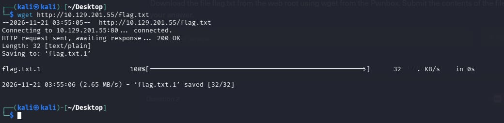
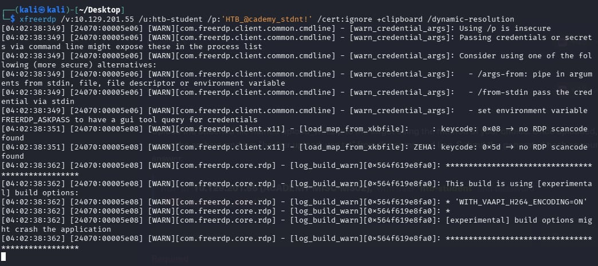
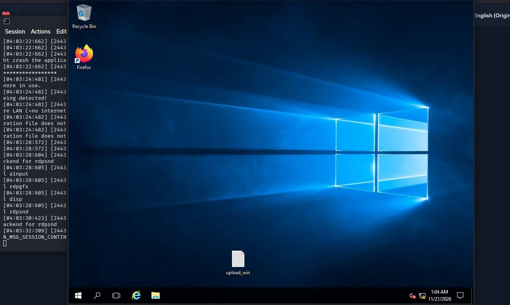
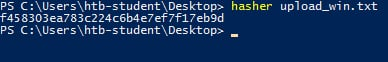
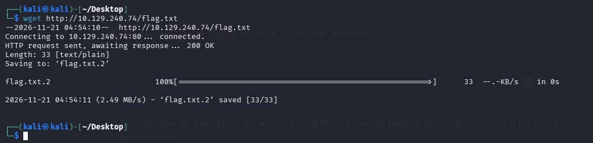
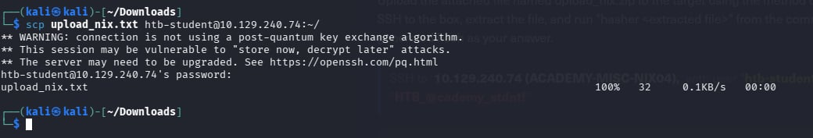
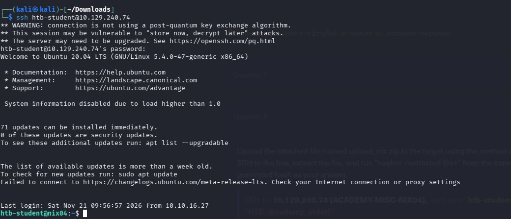
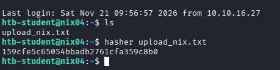

# Lời giải — File Transfers Module

### Q1: Download the file flag.txt from the web root using wget from the Pwnbox. Submit the contents of the file as your answer.

Dùng lệnh `wget http://<IP>/flag.txt`

> **Đáp án:** `b1a4ca918282fcd96004565521944a3b`

---

### Q2: Upload the attached file named upload_win.zip to the target using the method of your choice. Once uploaded, unzip the archive, and run "hasher upload_win.txt" from the command line. Submit the generated hash as your answer.

Đề bài gợi ý chúng ta kết nối với máy chủ thông qua giao thức `RDP`, thông qua `username` và `password` đã được cung cấp  
do đang chạy trên máy ảo `kali linux` nên dùng lệnh: `xfreerdp /v:<IP> /u:<username> /p:<password> /cert:ignore +clipboard /dynamic-resolution`  
`/cert:ignore`: Bỏ qua xác thực chứng chỉ SSL  
`+clipboard`: Bật đồng bộ clipboard cho phép chia sẻ dữ liệu giữa các client
`/dynamic-resolution`: Tự động thay đổi độ phân giải để dễ nhìn

Màn hình client hiện ra sau khi kết nối thành công

`hasher upload_win.txt`: tiến hành tạo ra mã băm cho file

> **Đáp án:** `f458303ea783c224c6b4e7ef7f17eb9d`

---

### Q3: Connect to the target machine via RDP and practice various file transfer operations (upload and download) with your attack host. Type "DONE" when finished.

> **Đáp án:** `DONE`

---

### Q4: Download the file flag.txt from the web root using Python from the Pwnbox. Submit the contents of the file as your answer.

Lệnh `wget http://<IP>/flag.txt` để lấy đáp án

> **Đáp án:** `5d21cf3da9c0ccb94f709e2559f3ea50`

---

### Q5: Upload the attached file named upload_nix.zip to the target using the method of your choice. Once uploaded, SSH to the box, extract the file, and run "hasher <extracted file>" from the command line. Submit the generated hash as your answer.

Ở phần này, đề bài yêu cầu truy cập máy chủ thông qua giao thức `SSH`, với `username` và `password` cho sẵn.  
Trước tiên, ta phải upload file lên máy chủ trước !!!  
`scp upload_nix.txt htb-student@<IP>:~/`

Sau khi đã upload thành công file `upload_nix.txt`, ta tiến hành ssh vào máy chủ  
`ssh htb-student@<IP>`

Tiến hành hash file rồi lấy đáp án !!!  
`hasher upload_nix.txt`

> **Đáp án:** `159cfe5c65054bbadb2761cfa359c8b0`

---

### Q6: Connect to the target machine via SSH and practice various file transfer operations (upload and download) with your attack host (workstation). Type "DONE" when finished.

> **Đáp án:** `DONE`

---

### Q7: Connect to the target machine via SSH (Username: htb-student | Password:HTB_@cademy_stdnt!) and practice various file transfer operations (upload and download) with your attack host. Type "DONE" when finished.

> **Đáp án:** `DONE`

---

### Q8: Use xfreerdp or rdesktop to connect to the target machine via RDP (Username: htb-student | Password:HTB_@cademy_stdnt!) and mount a Linux directory to practice file transfer operations (upload and download) with your attack host. Type "DONE" when finished.

> **Đáp án:** `DONE`

---

### Q9: Connect to the target machine via RDP ((Username: htb-student | Password:HTB_@cademy_stdnt!)) and use Living Off The Land techniques presented in this section or any other found on the LOLBAS and GTFOBins websites to transfer files between the Pwnbox and the Windows target. Type "DONE" when finished.

> **Đáp án:** `DONE`

---

