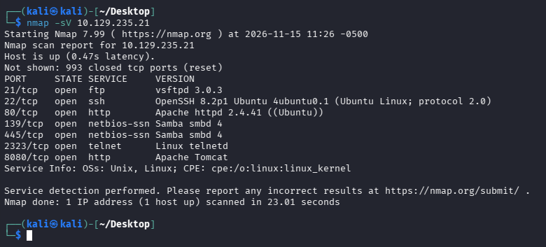
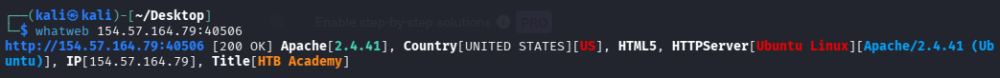
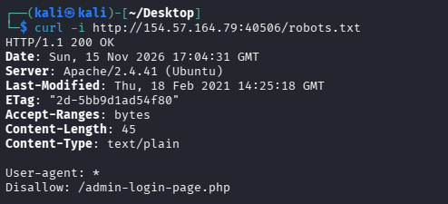

# Lời giải — Getting Started Module

### Q1: Apply what you learned in this section to grab the banner of the above server and submit it as the answer.

> **Đáp án:** `SSH-2.0-OpenSSH_8.2p1 Ubuntu-4ubuntu0.1`

---

### Q2: Perform an Nmap scan of the target. What does Nmap display as the version of the service running on port 8080?

Chạy lệnh: `nmap -sV 10.129.235.21`

> **Đáp án:** `Apache Tomcat`

---

### Q3: Perform an Nmap scan of the target and identify the non-default port that the telnet service is running on.

Nhìn từ bảng Nmap trên Q2:

> **Đáp án:** `2323`

---

### Q4: List the SMB shares available on the target host. Connect to the available share as the bob user. Once connected, access the folder called 'flag' and submit the contents of the flag.txt file.

Do ta đã biết người dùng “bob” sử dụng mật khẩu dễ đoán, mà trong bài lab đã gợi ý nên ta đoán được mật khẩu là: “Welcome1”.

Ta sử dụng giao thức SMB để kết nối:

Truy cập vào thư mục `flag`:

Sử dụng lệnh `GET` để lấy flag về:

> **Đáp án:** `dceece590f3284c3866305eb2473d099`

---

### Q5: Try running some of the web enumeration techniques you learned in this section on the server above, and use the info you get to get the flag.

Đầu tiên ta thử chạy lệnh `whatweb` để có cái nhìn sơ qua về web:

Khám phá sâu hơn, lần này mình sẽ dùng công cụ `gobuster` để tìm xem có file ẩn không:

File `robots.txt` là file thuộc tiêu chuẩn loại trừ của robot, dùng để chỉ thị những trình thu thập dữ liệu tự động biết được những thành phần nào trên trang web được phép hoặc không được phép truy cập. Tuy nhiên, nếu cấu hình sai, nó có thể làm lộ cấu trúc các thư mục ẩn của website.

Đúng như dự đoán, khi trỏ tới `robots.txt` thì ta có thể thấy một trang web ẩn ở mục **Disallow**. Vào thử trang web, ta thấy trang đăng nhập:

Dùng lệnh `curl -i http://154.57.164.79:40506/admin-login-page.php` để kiểm tra mã nguồn trang web, lập trình viên đã vô tình cấu hình sai, để lộ tài khoản và mật khẩu trong mã nguồn:

Dùng tài khoản và mật khẩu `admin:password123` để đăng nhập và lấy được flag:

> **Đáp án:** `HTB{w3b_3num3r4710n_r3v34l5_53cr375}`

---

### Q6: Try to identify the services running on the server above, and then try to search to find public exploits to exploit them. Once you do, try to get the content of the '/flag.txt' file. (note: the web server may take a few seconds to start)