# Lời giải — Password Attacks

### Q1: What is the SHA1 hash for `Academy#2025`?

Ta tìm mã hash `SHA1` của từ khóa `Academy#2025`

> **Đáp án:** `750fe4b402dc9f91cedf09b652543cd85406be8c`

---

### Q2: Use single-crack mode to crack r0lf's password.

Do đã biết password hash của r0lf, mình sẽ dán thông tin này vào file passwd để tiến hành john ripper file đấy

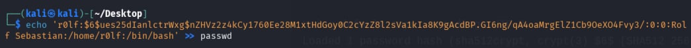

lệnh: `echo 'r0lf:$6$ues25dIanlctrWxg$nZHVz2z4kCy1760Ee28M1xtHdGoy0C2cYzZ8l2sVa1kIa8K9gAcdBP.GI6ng/qA4oaMrgElZ1Cb9OeXO4Fvy3/:0:0:Rolf Sebastian:/home/r0lf:/bin/bash' > passwd`

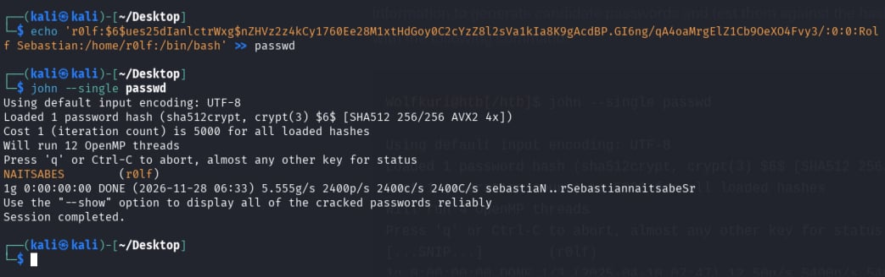

từ file password hash, mình sẽ dùng lệnh: `john --single passwd` để tiến hành single crack file này

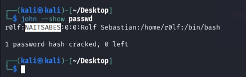

`john --show passwd` để xem đáp án

> **Đáp án:** `NAITSABES`

---

### Q3: Use wordlist-mode with rockyou.txt to crack the RIPEMD-128 password.

Ban đầu, tiến hành lưu thông tin password hash vào 1 file  
lệnh: `echo '193069ceb0461e1d40d216e32c79c704' > hash.txt`

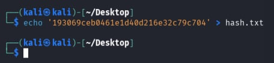

Tiếp đến, mình sẽ dùng bộ từ điển `rockyou` để tiến hành giải mã hash  
Câu lệnh: `john --format=ripemd-128 --wordlist=/usr/share/wordlists/rockyou.txt hash.txt`

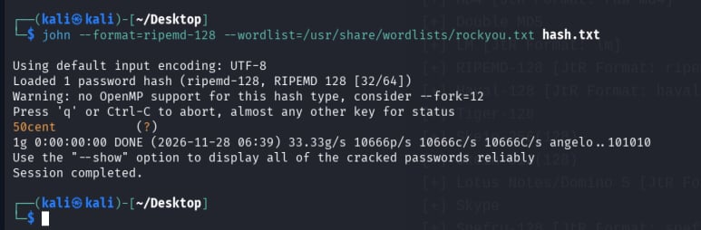

Lấy đáp án

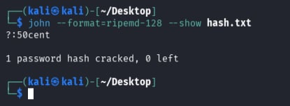

> **Đáp án:** `50cent`

---

### Q4: Use a dictionary attack to crack the first password hash. (Hash: e3e3ec5831ad5e7288241960e5d4fdb8)

Trong bài này, mình sẽ tiếp tục sử dụng bộ từ điển `rockyou` để giải password hash:  
câu lệnh: `hashcat -a 0 -m 0 e3e3ec5831ad5e7288241960e5d4fdb8 /usr/share/wordlists/rockyou.txt`

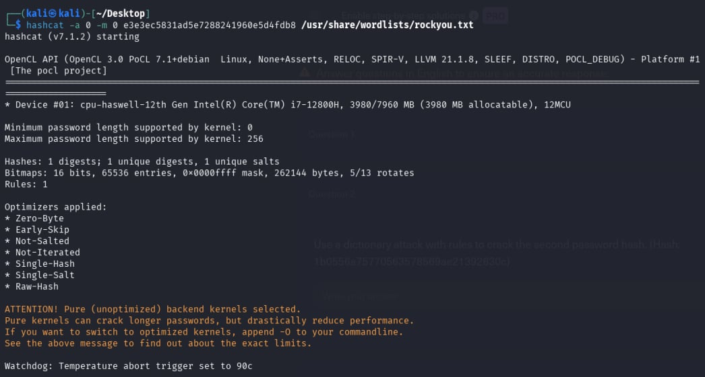

Lấy đáp án: 

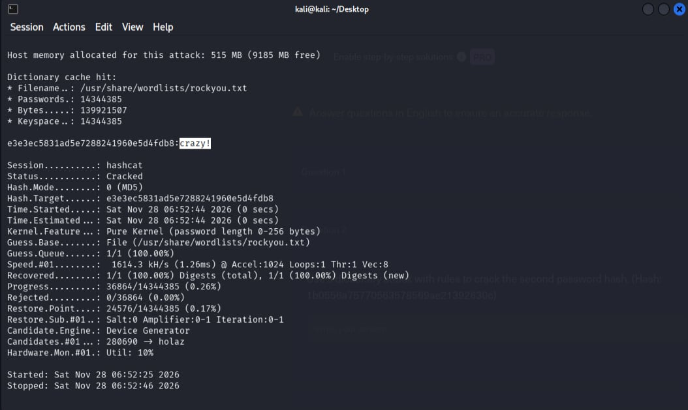

> **Đáp án:** `crazy!`

---

### Q5: Use a dictionary attack with rules to crack the second password hash. (Hash: 1b0556a75770563578569ae21392630c)

Ở bài này, ta cần phải cấu hình thêm cả `rules` trong hashcat thì mới giải được, mình sẽ liệt kê các `rules` hiện có trong hashcat và xem thử cái nào phù hợp: 
Lệnh: `ls -l /usr/share/hashcat/rules`

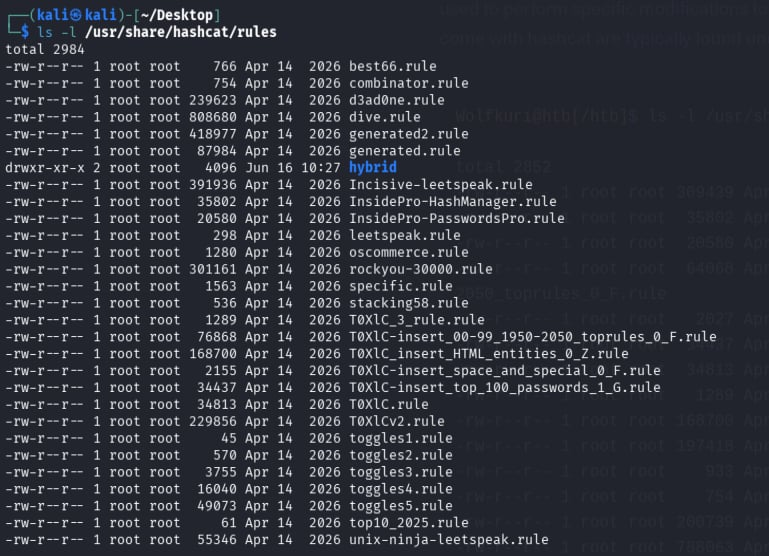

`rules` mà mình sẽ dùng trong hashcat là: `best66.rule`  
Dựa như password hash đã cung cấp, mình sẽ chạy câu lệnh kết hợp bộ từ điển `rockyou.txt` và `best66.rule` để lấy đáp án  
Câu lệnh: `hashcat -a 0 -m 0 1b0556a75770563578569ae21392630c /usr/share/wordlists/rockyou.txt -r /usr/share/hashcat/rules/best66.rule`

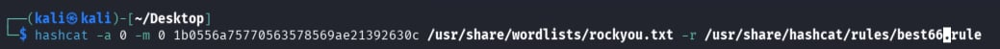

Chạy lệnh rồi lấy đáp án: 

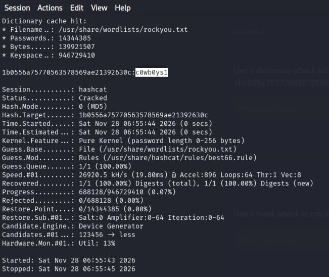

> **Đáp án:** `c0wb0ys1`

---

### Q6: Use a mask attack to crack the third password hash. (Hash: 1e293d6912d074c0fd15844d803400dd)

