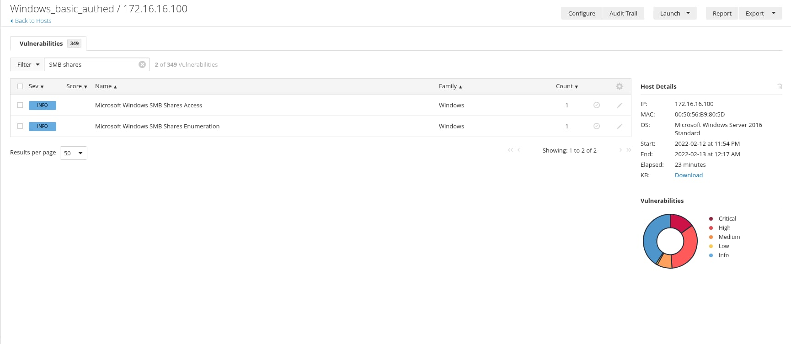
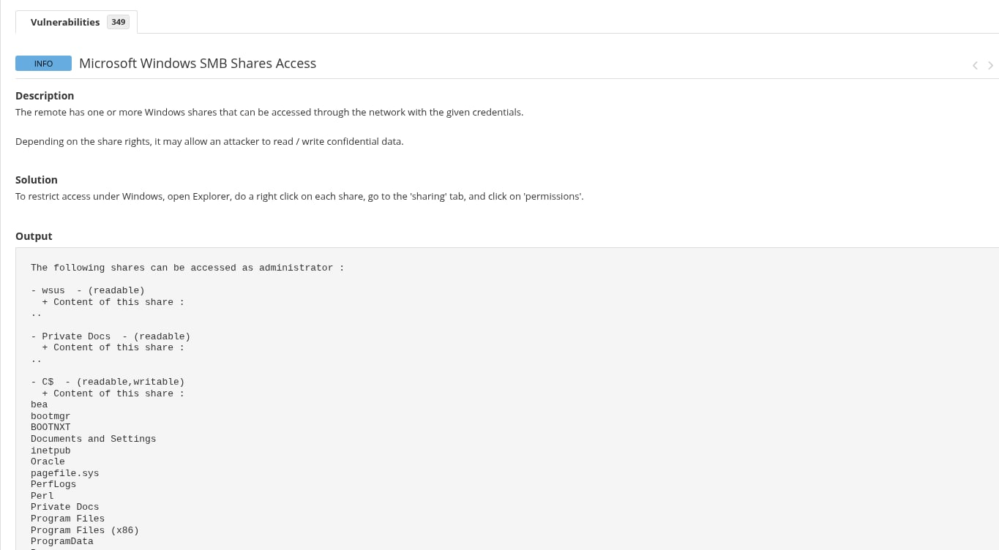
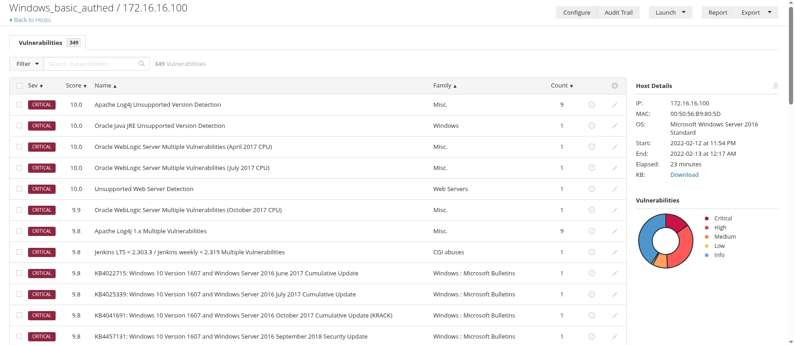
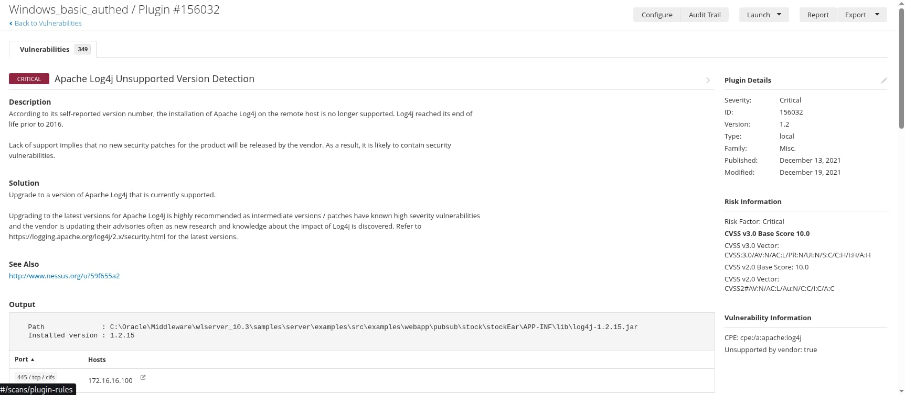
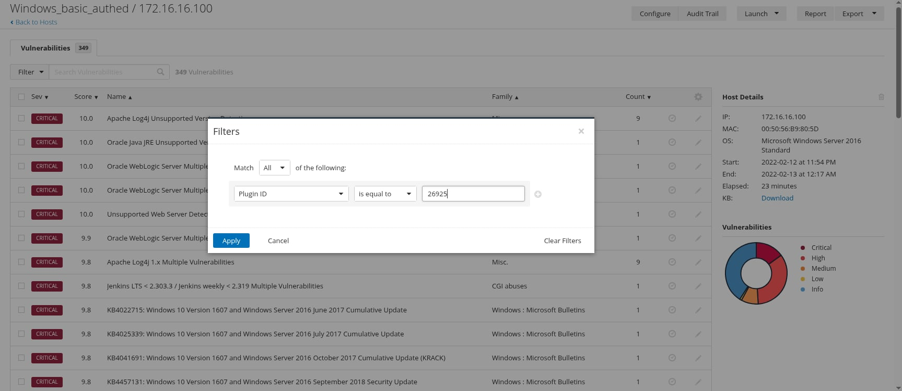
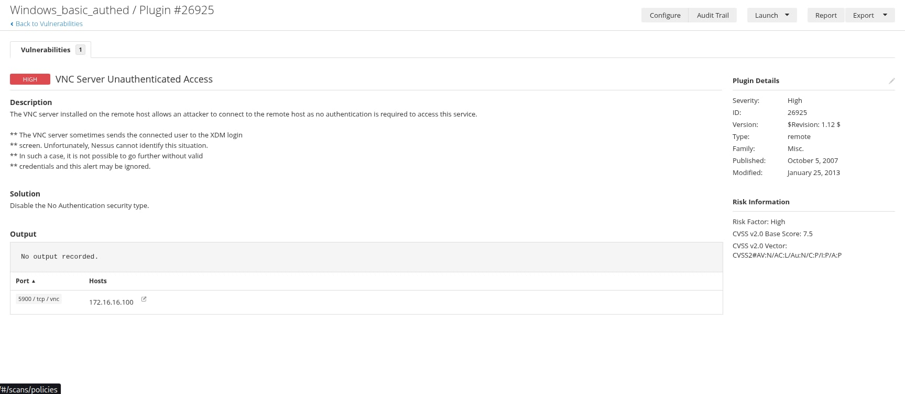
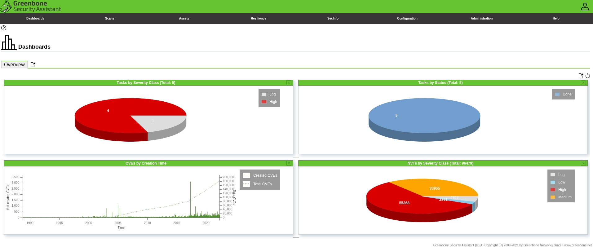
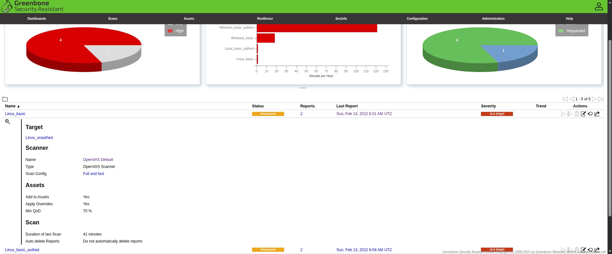
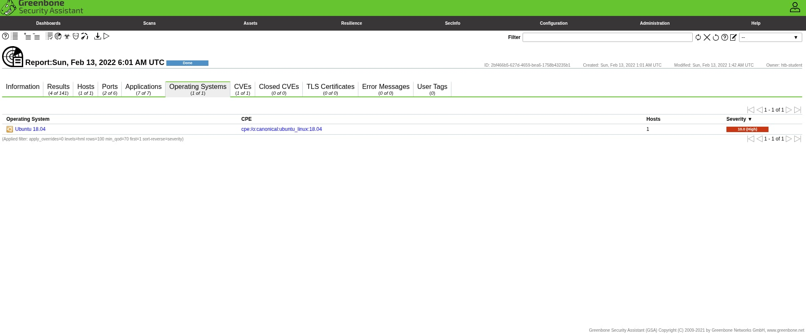
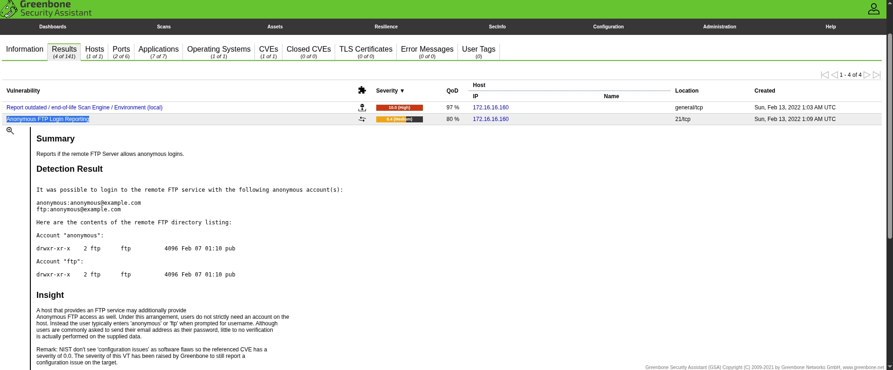

# Lời giải — Vulnerability Assessment

### Q1: What is the name of one of the accessible SMB shares from the authenticated Windows scan? (One word)
Truy cập vào mục kết quả scan: `Windows_basic_authed`
ta lọc thanh tìm kiếm: `SMB shares`

Vào sâu hơn, ta thấy gồm có 4 SMB shares có thể truy cập được gồm: `ADMIN$` `C$` `IPC$` `wsus`, do để bài chỉ bắt điền "One word"

> **Đáp án:** `wsus`

---

### Q2: What was the target for the authenticated scan?

IP mục tiêu bị scan là `172.16.16.100`

> **Đáp án:** `172.16.16.100`

---

### Q3: What is the plugin ID of the highest criticality vulnerability for the Windows authenticated scan?
Ngay trên đầu đề mục, có `Plugin_ID: 156032`

> **Đáp án:** `156032`

---

### Q4: What is the name of the vulnerability with plugin ID 26925 from the Windows authenticated scan? (Case sensitive)

Lọc `plugin ID = 26925` theo như yêu cầu đề bài

> **Đáp án:** `VNC Server Unauthenticated Access`

---

### Q5: What port is the VNC server running on in the authenticated Windows scan?

Mục output của `Plugin #26925`
Ta nhìn được thông tin:\
 `Port: 5900/tcp/vnc` \
 `Hosts: 172.16.16.100`

> **Đáp án:** `5900`

---

### Q6: What type of operating system is the Linux host running? (one word)

Ở giao diện ban đầu, vào mục `Scans` rồi tìm đến `Report: Linux_basic`

Vào trong Report, ở mục `OS (Operating Systems)`

> **Đáp án:** `Ubuntu`

---

### Q7: What type of FTP vulnerability is on the Linux host? (Case Sensitive, four words)

Chuyển sang tab Results ta thấy:

> **Đáp án:** `Anonymous FTP Login Reporting`

---

### Q8: What is the IP of the Linux host targeted for the scan?

Vẫn ở tab `Results` nhìn sang cột `Host`

> **Đáp án:** `172.16.16.160`

---

### Q9: What vulnerability is associated with the HTTP server? (Case-sensitive)

> **Đáp án:** `Cleartext Transmission of Sensitive Information via HTTP`

---